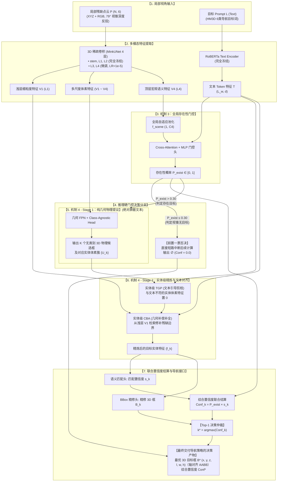
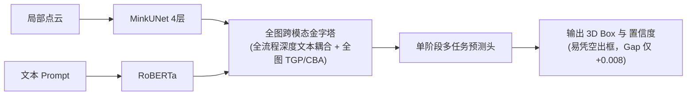
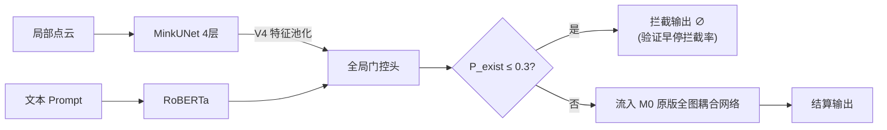
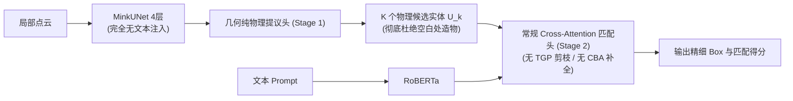
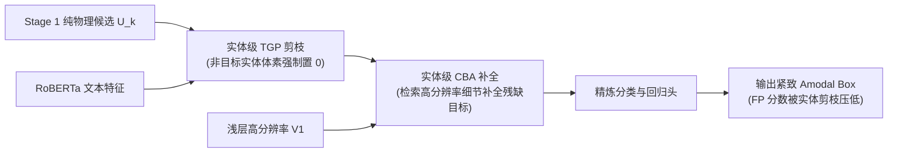

# Project VLVM Stage3: 3D Native 主动视觉语言导航系统 · 实验安排和结果

## 全任务联合损失总函数与架构开关

损失函数由**五部分**组成——`base / gate / s1 / s2 / distill`：base **恒定生效**，其余四项由消融开关启闭：

$$\mathcal{L}_{\text{total}} = \mathcal{L}_{\text{base}} + \mathbb{I}_{\text{Gate}} \cdot \lambda_{\text{gate}} \mathcal{L}_{\text{gate}} + \mathbb{I}_{\text{Prop}} \cdot \lambda_{s1} \mathcal{L}_{s1} + \mathbb{I}_{\text{Refine}} \cdot \lambda_{s2} \mathcal{L}_{s2} + \mathbb{I}_{\text{Distill}} \cdot \lambda_{\text{distill}} \mathcal{L}_{\text{distill}}$$

- **五部分结构**：
  1) **base（恒定）** = $\mathcal{L}_{\text{cls\_base}}$（ASL）+ $\mathcal{L}_{\text{l1\_base}}$ + $\mathcal{L}_{\text{giou3d\_base}}$ + **$\mathcal{L}_{\text{bg}}$**；
  2) **gate（$\mathbb{I}_{\text{Gate}}$）**；
  3) **s1（$\mathbb{I}_{\text{Prop}}$）**；
  4) **s2（$\mathbb{I}_{\text{Refine}}$）**；
  5) **distill（$\mathbb{I}_{\text{Distill}}$）** = 门控软标签蒸馏 $\mathcal{L}_{\text{gate\_dist}}$

- **基准平衡权重**：
  $\lambda_{\text{gate}} = 1.0, \quad \lambda_{s1} = 1.0, \quad \lambda_{s2} = 1.0$；
  base 内部系数 $\lambda_{\text{l1}} = \lambda_{\text{giou}} = \lambda_{\text{bg}} = 1.0$；
  $\lambda_{\text{distill}} = 1.0$；
- **内部子项基准系数**：
  $\lambda_{\text{box1}} = \lambda_{\text{giou1}} = 1.0$；
  $\lambda_{\text{box2}} = \lambda_{\text{giou2}} = \lambda_{\text{tgp}} = 1.0$；

### 1. 终局任务底座损失：$\mathcal{L}\_{\text{base}}$（恒定生效，含 $\mathcal{L}_{\text{bg}}$）

> **定位**：$\mathcal{L}_{\text{base}}$ **始终生效**，直接监督网络最终交付给导航决策的 Top-1 预测产物与真实 3D GT 之间的误差；并恒常携带 $\mathcal{L}_{\text{bg}}$（负视锥二次压制）。

$$\mathcal{L}_{\text{base}} = \mathcal{L}_{\text{cls\_base}} + \mathbb{I}(y_{\text{exist}} = 1) \cdot \Big( \lambda_{\text{l1}} \mathcal{L}_{\text{l1\_base}} + \lambda_{\text{giou}} \mathcal{L}_{\text{giou3d\_base}} \Big) + \lambda_{\text{bg}} \mathcal{L}_{\text{bg}}$$

- **$\mathcal{L}_{\text{cls\_base}}$（终端置信度损失，ASL）**：
  $$\mathcal{L}_{\text{cls\_base}} = \frac{1}{K} \sum_{k=1}^K \ell_{\text{asl}}(p_k, \hat{y}_k)$$
  $$\ell_{\text{asl}}(p_k, \hat{y}_k) = \begin{cases} 
  - (1 - p_k)^{\gamma_+} \log(p_k + \epsilon), & \text{若 } \hat{y}_k = 1 \\ 
  - (p_k)^{\gamma_-} \log(1 - p_k + \epsilon), & \text{若 } \hat{y}_k = 0 
  \end{cases}$$
  - **参数**：$\gamma_+ = 1.0, \ \gamma_- = 4.0$；
  - **标签 $\hat{y}_k$ 与匹配口径**：匹配 = 提议与视锥内真目标 GT AABB 的匈牙利匹配（成本 $= 1 - \text{IoU}_{\text{3D}}$）；若视锥包含真目标（$y_{\text{exist}}=1$），匹配上的唯一项赋 $\hat{y}_{k^*} = 1$，**其余（含与目标高重叠的重复提议）全部赋 0**；若视锥无目标（$y_{\text{exist}}=0$），所有 $K$ 项全部赋 0。

- **$\mathcal{L}_{\text{l1\_base}}$（3D 边界框物理对齐，轴对齐 AABB，无 Yaw）**：
  仅对正样本 $k^*$ 计算（框为 canonical 系轴对齐 6 元组 $(x, y, z, l, w, h)$，与数据层 GT、头输出维度、在线消费口径一致；yaw 项已收敛删除）：
  $$\mathcal{L}_{\text{l1\_base}} = \underbrace{\|\hat{c}_{k^*} - c^{\text{gt}}\|_1}_{\text{中心位置}} + \underbrace{\|\log(\hat{\mathbf{d}}_{k^*}) - \log(\mathbf{d}^{\text{gt}})\|_1}_{\text{尺寸对数尺度}}$$
- **$\mathcal{L}_{\text{giou3d\_base}}$（终局 3D GIoU 空间包络损失）**：
  $$\mathcal{L}_{\text{giou3d\_base}} = 1 - \text{GIoU}_{\text{3D}}(\hat{B}_{k^*}, B^{\text{gt}})$$
- **$\mathcal{L}_{\text{bg}}$（负视锥二次压制）**：
  $$\mathcal{L}_{\text{bg}} = \mathbb{I}(y_{\text{exist}} = 0) \cdot \frac{1}{K} \sum_{k=1}^{K} (s_k)^2$$
  - **梯度形态与分工**：二次型对中段分数（0.3–0.7）压制强（$p=0.5$ 处梯度 $2p = 1.0$），而 ASL $\gamma_- = 4$ 在 $p < 0.3$ 的负样本梯度仅 $\sim 10^{-2}$ 量级 ⇒ 两者作用面互补：ASL 集中压制高分端（743 早停诱因），$\mathcal{L}_{\text{bg}}$ 覆盖中段“分数堆积”型幻觉；
  - **口径**：$s_k$ = 候选 $k$ 的交付置信度（框头输出，与 $\mathcal{L}_{\text{cls\_base}}$ 的 $p_k$ 同一量）；×record `weight`（负样本恒 1.0）；reduction = 批内均值；$K$ = 候选槽位数。

### 2. 全局存在性门控损失：$\mathcal{L}\_{\text{gate}}$（Presence Gate Loss；消融：$\mathbb{I}_{\text{Gate}}$）

> **定位**：监督门控头（`layer4` 全局池化 Token × 文本 Token 的 Cross-Attention + MLP）输出的 $P_{\text{exist}} = \sigma(z_{\text{gate}})$。

$$\mathcal{L}_{\text{gate}} = - \alpha_{\text{gate}} (1 - P_{\text{exist}})^{\gamma} y_{\text{exist}} \log(P_{\text{exist}} + \epsilon) - (1 - \alpha_{\text{gate}}) P_{\text{exist}}^{\gamma} (1 - y_{\text{exist}}) \log(1 - P_{\text{exist}} + \epsilon)$$

- **标签口径**：$y_{\text{exist}} = \text{record 的 } \texttt{label}$；“存在” = 查询类在本视图内**任一实例像素 $\ge$ `min_vis_px`(40)**；“不存在” = 该类所有实例像素 $< 40$（弱可见 $1\sim39$ px 或完全不可见）；负样本池含“类存在于场景、但本视图不可见”——正是 743 起早停的同分布硬负例；且取“任一实例”判定 ⇒ 不受单实例标注残差影响；
- **超参数（首轮基准）**：$\gamma = 2.0$、$\epsilon = 10^{-6}$；$\alpha_{\text{gate}}$ 按“精确抵消样本配比”的闭式取 $\alpha_{\text{gate}} = n_{\text{neg}}/(n_{\text{pos}} + n_{\text{neg}})$（设计配比 1:3 ⇒ $0.75$）；生成完成后按 `stats.json` 实测 pos/neg 复核；
- **样本权重与归约**：乘 record 的 `weight`（高截断正样本记 0.5，与其它损失同口径；负样本恒 1.0）；reduction = 批内均值；
- **梯度边界（属“训练/推理严格解耦”的一部分）**：交付侧 $Conf_k = P_{\text{exist}} \times s_k$ 的乘子在训练期对 $P_{\text{exist}}$ **停止梯度（detach）**——切断的是框损失（ASL / 匹配）经乘子对 $P_{\text{exist}}$ 的耦合；门控头由 $\mathcal{L}_{\text{gate}}$（真值监督）+ $\mathcal{L}_{\text{gate\_dist}}$（教师蒸馏）双源监督（二者不冲突），保证 $\tau_{\text{gate}}$ 可离线校准；推理期照常相乘；
- **阈值**：$\tau_{\text{gate}}$ 不在训练目标内，属**训练后校准量**；
- **边界**：“可见但云内目标点 $<40$”的（视图, 类）对在生成期整体剔除（既非正也非负）⇒ 门控不覆盖“稀疏可见”情形；
- **训练期行为**：软前向、严禁硬截断。

### 3. Stage 1 纯几何提议损失：$\mathcal{L}\_{s1}$（消融：$\mathbb{I}_{\text{Prop}}$）

> **定位**：完全屏蔽文本。从局部残缺点云中提取 $K$ 个“客观存在的物理候选框”及其物体性。

$$\mathcal{L}_{s1} = \mathcal{L}_{\text{obj\_s1}} + \mathbb{I}(N_{\text{gt\_obj}} > 0) \cdot \Big( \lambda_{\text{box1}} \mathcal{L}_{\text{box\_s1}} + \lambda_{\text{giou1}} \mathcal{L}_{\text{giou3d\_s1}} \Big)$$

- **$\mathcal{L}_{\text{obj\_s1}}$（纯几何物体性损失，采用标准 Focal Loss）**：
  $$\mathcal{L}_{\text{obj\_s1}} = \frac{1}{K} \sum_{k=1}^K \text{FL}(p_k^{\text{obj}}, \hat{y}_k^{\text{obj}})$$
  $$\text{FL}(p, y) = - \alpha (1 - p_t)^\gamma \log(p_t), \quad p_t = y \cdot p + (1 - y)(1 - p)$$
  - **参数**：$\alpha = 0.5, \ \gamma = 2.0$；
  - **行为与匹配口径**：$\hat{y}_k^{\text{obj}}$ 由提议与视锥内**可见实体的 GT AABB** 做匈牙利匹配（成本 $= 1 - \text{IoU}_{\text{3D}}$）给出，$N_{\text{gt\_obj}}$ = 匹配上的实体数；在多物体视锥中匹配所有物理实体；在空白视锥（白墙）中所有 $\hat{y}_k^{\text{obj}} = 0$，将物体性压制趋向于 0。

- **$\mathcal{L}_{\text{box\_s1}}$（粗糙几何物理框 L1 回归，无 Yaw 对齐）**：
  $$\mathcal{L}_{\text{box\_s1}} = \frac{1}{N_{\text{pos1}}} \sum_{k \in \mathcal{P}_{\text{pos1}}} \Big( \|\hat{c}_k - c_k^{\text{gt}}\|_1 + \|\log(\hat{\mathbf{d}}_k) - \log(\mathbf{d}_k^{\text{gt}})\|_1 \Big)$$

- **$\mathcal{L}_{\text{giou3d\_s1}}$（粗框 3D GIoU 空间重叠约束）**：
  $$\mathcal{L}_{\text{giou3d\_s1}} = \frac{1}{N_{\text{pos1}}} \sum_{k \in \mathcal{P}_{\text{pos1}}} \Big( 1 - \text{GIoU}_{\text{3D}}(B_k^{\text{prop}}, B_k^{\text{gt}}) \Big)$$

### 4. Stage 2 实体精炼与匹配损失：$\mathcal{L}\_{s2}$（消融：$\mathbb{I}_{\text{Refine}}$）

> **定位**：在纯几何提议簇 $\{U_k\}$ 上引入文本交互。通过 TGP 实体体素剪枝压制非目标，通过 CBA 补全 Amodal 框。

$$\mathcal{L}_{s2} = \mathcal{L}_{\text{match\_s2}} + \mathbb{I}(y_{\text{exist}} = 1) \cdot \Big( \lambda_{\text{box2}} \mathcal{L}_{\text{box\_s2}} + \lambda_{\text{giou2}} \mathcal{L}_{\text{giou3d\_s2}} \Big) + \mathbb{I}_{\text{TGP}} \cdot \lambda_{\text{tgp}} \mathcal{L}_{\text{tgp\_s2}}$$

- **$\mathcal{L}_{\text{match\_s2}}$（中间实体匹配置信度，采用 Focal Loss）**：
  $$\mathcal{L}_{\text{match\_s2}} = \frac{1}{K} \sum_{k=1}^K \text{FL}(p_k^{\text{match}}, \hat{y}_k^{\text{match}})$$
  - **参数**：$\alpha = 0.25, \ \gamma = 2.0$（处理候选正负失衡，保障中间特征平滑流转）；
  - **匹配口径**：与 $\mathcal{L}_{\text{base}}$ 相同（提议 ↔ 文本真目标的匈牙利匹配，成本 $= 1 - \text{IoU}_{\text{3D}}$），仅匹配项 $\hat{y}_{k^*}^{\text{match}} = 1$。

- **$\mathcal{L}_{\text{box\_s2}}$ 与 $\mathcal{L}_{\text{giou3d\_s2}}$（精修框空间回归，无 Yaw 对齐）**：
  - 仅对匹配到文本真目标的提议计算，中心位置与尺寸对数 L1 + 3D GIoU：
    $$\mathcal{L}_{\text{box\_s2}} = \|\hat{c}_{k^*} - c^{\text{gt}}\|_1 + \|\log(\hat{\mathbf{d}}_{k^*}) - \log(\mathbf{d}^{\text{gt}})\|_1$$
    $$\mathcal{L}_{\text{giou3d\_s2}} = 1 - \text{GIoU}_{\text{3D}}(\hat{B}_{k^*}^{\text{refine}}, B^{\text{gt}})$$

- **$\mathcal{L}_{\text{tgp\_s2}}$（TGP 体素剪枝显式监督，采用 BCE；体素级几何掩码）**：
  $$\mathcal{L}_{\text{tgp\_s2}} = \frac{1}{K} \sum_{k=1}^K \frac{1}{|U_k|} \sum_{v \in U_k} \text{BCE}\Big( M_k(v), M_k^*(v) \Big)$$
  - 掩码 $M^*$ 由**几何包含判定**给出：体素落在目标实例 GT AABB 内（含 `box_margin`=0.05 m，与数据层 `target_pts` 同一判定）⇒ 1，否则 ⇒ 0；无目标视图（$y_{\text{exist}}=0$）全部置 0。**不经过“簇→实体归属”步骤**；
  - 语义：跨实体 / 贴墙的混合簇自动获得逐体素的 0/1 混合信号（不会整簇翻转）；非目标实体簇的体素天然在目标 AABB 外 ⇒ 全 0（拒识目标不变）；
  - **簇级等权归一化**：先簇内平均、再跨簇平均 ⇒ 每个提议对损失的权重相同，避免大簇按体素数放大占比；
  - **实现边界**：现有 `forward_test` 的剪枝掩码在 `torch.no_grad()` 内计算、`MinkowskiPruning` 不可导 ⇒ 现成 `keep_conv`/`com_cls` 通路无梯度；本损失的梯度通路须随 M2/M3 的实体级前向重建。

### 5. 蒸馏损失：$\mathcal{L}\_{\text{distill}}$（消融：$\mathbb{I}_{\text{Distill}}$）

> **定位**：蒸馏机制在损失面上的接入点。**启用门控软标签项 $\mathcal{L}_{\text{gate\_dist}}$**（教师 = GD 侧车输出；学生 = 门控输出 $P_{\text{exist}}$）。

$$\mathcal{L}_{\text{gate\_dist}} = - \alpha\, \hat{Y}_{\text{GD}} \log(P_{\text{exist}} + \epsilon) - (1 - \alpha)\,(1 - \hat{Y}_{\text{GD}}) \log(1 - P_{\text{exist}} + \epsilon), \qquad \hat{Y}_{\text{GD}} = \sigma\!\Big(\frac{\mathrm{logit}(S^{\max}_{2D})}{T}\Big)$$

- **教师信号**：$S^{\max}_{2D}$ = 该视图**全部帧**对目标类的最高检出置信度（无检出取 0；$\mathrm{logit}(0)$ 不可直接计算，代码先 clamp $S \in [10^{-6}, 1-10^{-6}]$，此时 $\hat{Y}_{\text{GD}} \to 0$）；$T = 1.5$ 温度平滑（防极端偶发误检）；$\hat{Y}_{\text{GD}}$ 严格 detach；仅 `ok` 帧 + 深度支撑（$n \ge 40$、$z \in [0.5, 5.0]$）+ GT 投影验证（正样本教师 0 ⇒ 弃权）后参与（§4（2））；
- **配平与归约**：正类项权重 $\alpha_{\text{distill}} = n_{\text{neg}}/(n_{\text{pos}} + n_{\text{neg}})$（同 $\alpha_{\text{gate}}$ 闭式，1:3 ⇒ $0.75$）；$\epsilon = 10^{-6}$；×record `weight`（负样本恒 1.0）；reduction = 批内均值；
- **与 $\mathcal{L}_{\text{gate}}$ 不冲突**：两者作用于同一 $P_{\text{exist}}$——真值硬标签（加权 Focal）+ 教师软标签（软-BCE）双源监督；一致样本梯度同向叠加；分歧样本分类处理：正样本 GD 漏检（教师 0）⇒ 弃权，负样本 GD 误检（教师 > 0）⇒ 保留（有意的召回侧偏置：门控 FN 不可恢复，统计并记录）；蒸馏补的是边界视图上真值 0/1 之外的平滑先验；
- **梯度边界**：$\hat{Y}_{\text{GD}}$ 侧 detach；框损失经 $Conf_k$ 乘子对 $P_{\text{exist}}$ 的路径已切断 ⇒ $P_{\text{exist}}$ 的梯度仅来自 $\mathcal{L}_{\text{gate}} + \lambda_{\text{distill}} \mathcal{L}_{\text{gate\_dist}}$，保证 $\tau_{\text{gate}}$ 可离线校准；
- **数据依赖**：GD 侧车为训练期必需输入；推理端无教师（蒸馏天然 train-only）。

## 实验数据流

### 完整系统推理数据流图

以下展示在单步局部视角输入下的完整在线推理数据流：

### 架构消融各档位数据流对比（Ablation Dataflows）

各消融档位通过对数据流分支的开启、绕行与替换，精确控制变量：

#### 1. M0 (Baseline: 原版耦合架构)

#### 2. M1 (+Gate: 原版 + 存在性门控外挂)

#### 3. M2 (Decouple-Plain: 几何成框与语义判别原生解耦)

#### 4. M3 (+TGP/CBA: 实体级硬剪枝与几何补全精炼)

## 实验执行安排：五档损失消融与双机权重生成

> 目标：量化每个损失项的独立贡献（单变量）并生成 5 档可上线比较的微调权重；
> 训练只消费本地静态数据，导航场景不参与。

### 1. 五档定义（base 恒定 + 单损失开关）

| 档名 | 训练损失 | 模型开关 | 单变量目的 |
| :--- | :--- | :--- | :--- |
| `base` | base（含 $\mathcal{L}_{\text{bg}}$） | 原版路径（无新头） | 局部切片下的基线（ASL + L1 + GIoU + bg） |
| `gate` | base + $\mathcal{L}_{\text{gate}}$ | + 门控头 | 门控独立贡献（早停拦截） |
| `s1` | base + $\mathcal{L}_{s1}$ | + Stage 1 提议头 | 纯几何提议的候选纯度贡献 |
| `s2` | base + $\mathcal{L}_{s2}$（含 TGP） | + Stage 1/2 实体分支（含 TGP/CBA） | 实体级精炼独立贡献 |
| `distill` | base + $\mathcal{L}_{\text{gate\_dist}}$ | + 门控头（仅蒸馏监督） | GD 软标签的边界平滑贡献 |

### 2. 双机分工（权重生成分两部分）

| 机器 | 队列 | 说明 |
| :--- | :--- | :--- |
| A | `base → gate → s1` | **每机 base 单独跑一次**（A/B 两组 base 互为复现对照） |
| B | `base → s2 → distill` | 消融分开跑（gate/s1 与 s2/distill 互不重叠） |

- 运行：`MACHINE=a bash scripts/ft_tsp3d.sh` / `MACHINE=b bash scripts/ft_tsp3d.sh`；
- 断点续跑 `SKIP_DONE=1`；冒烟示例：`LIMIT=2 SCENES=00006-HkseAnWCgqk EPOCHS=1 VAL_EVERY=0 TASK=base bash scripts/ft_tsp3d.sh`；

### 3. 训练数据口径（生成权重只用 train + val 两个数据集）

| 数据 | 角色 |
| :--- | :--- |
| train（23,038 views / 89,624 records） | **唯一**参与梯度 |
| val（2,638 views / 10,360 records） | 仅监控 + $\tau_{\text{gate}}$ 校准（不参与梯度） |
| nav 20 场景 | 不生成合成样本；仅用于在线评测 |

## 首轮评测

### 1. 首轮结果

**主表（全部完成档；单场景 `5cdEh9F2hJL` × 99 集）**

| 档位（权重加载时刻） | 权重 | 机 | SR | Oracle | spl | soft_spl | steps | stop_called |
| :--- | :--- | :--- | :--- | :--- | :--- | :--- | :--- | :--- |
| base · σ0.70（09-30 10:56） | `base_5080_ckpt_last.pth` | 5080 | **27.27%** | 66.67% | 0.0759 | 0.1215 | 367.0 | 0.414 |
| base · σ0.60（09-30 17:32；σ_tar 0.70→0.60） | `base_5080_ckpt_last.pth` | 5080 | 22.22% | 57.58% | 0.0925 | 0.1812 | 283.8 | 0.596 |
| s2（10-01 10:55） | `s2_5080_ckpt_last.pth` | 5080 | 6.06% | 71.72% | 0.0060 | 0.0487 | 483.0 | 0.061 |
| distill（10-01 15:41） | `distill_5080_ckpt_last.pth` | 5080 | 2.02% | 72.73% | 0.0017 | 0.0461 | 491.1 | 0.000 |
| s1（10-01 20:47） | `s1_5080_ckpt_last.pth` | 5080 | 7.07% | 69.70% | 0.0193 | 0.0629 | 459.9 | 0.111 |
| 定稿管线对照 | `tsp3d_scanrefer.pth` | — | 56.57% | 55.56% | — | — | — | — |
| GD-关历史参照 | `tsp3d_scanrefer.pth` | — | 44.44% | 54.55% | — | — | — | — |

**检测级判读（日志尾部汇总块）**

| 档位 | det（进 S 门前；tp / fp） | precision | 含 tp 检出集 | 记忆条目（tp） | Oracle 子集失败构成 | gate 拒（conflict / low_conf） |
| :--- | :--- | :--- | :--- | :--- | :--- | :--- |
| base · σ0.70 | **208**（139 / 69） | 66.8% | 26/42 | 46（24 · 52.2%） | fn 35 / fp 4（39/66） | 4 / 125 |
| base · σ0.60 | 197（89 / 108） | 45.2% | 25/60 | 75（26 · 34.7%） | fn 24 / fp 12（36/57） | 1 / 63 |
| s2 | 20（0 / 20） | 0.0% | 0/14 | 8（0 · 0.0%） | fn 64 / fp 1（65/71） | 1 / 11 |
| distill | **0 条**（全程无检测输出） | — | — | — | fn 70 / fp 0（70/72） | — |
| s1 | 40（5 / 35） | 12.5% | 5/24 | 11（3 · 27.3%） | fn 60 / fp 2（62/69） | 2 / 27 |
| 定稿管线对照 | ~640（tp ~204） | ~32% | — | ~190 条 | fp 锁假主导 | — |

**在线 tp-fp 分数分离（判别力；日志 `maxscore` 分布）**

| 档位 | tp 分数 mean / p50 | fp 分数 mean / p50 | gap（mean） |
| :--- | :--- | :--- | :--- |
| base · σ0.70 | 0.762 / 0.758 | 0.748 / 0.741 | +0.014 |
| base · σ0.60 | 0.694 / 0.696 | 0.663 / 0.644 | +0.031 |
| s2 | —（tp = 0） | 0.781 / 0.753 | — |
| distill | — | — | — |
| s1 | 0.734 / 0.731 | **0.795 / 0.743** | **−0.061**（fp 高于 tp） |

**逐类检测（det（tp · prec）；定稿量级对照为各类均衡）**

| 目标类 | base · σ0.70 | base · σ0.60 | s2 | s1 |
| :--- | :--- | :--- | :--- | :--- |
| chair | 175（129 · 73.7%） | 137（70 · 51.1%） | 6（0 · 0%） | 24（3 · 12.5%） |
| couch | 32（9 · 28.1%） | 32（4 · 12.5%） | 9（0 · 0%） | 5（1 · 20.0%） |
| bed | 1（1 · 100%） | 8（8 · 100%） | 4（0 · 0%） | 6（1 · 16.7%） |
| toilet | 0 | 4（1 · 25.0%） | 0 | 3（0 · 0%） |
| tv | 0 | 16（6 · 37.5%） | 1（0 · 0%） | 2（0 · 0%） |

定稿 5cdE 逐类 SR（09-18）：bed 94.4% · chair 95.5% · toilet 56.2% · couch 30.4% · tv 10.0%。⇒ base 微调后 bed/toilet/tv 检测近乎清零、失败翻转为 fn 主导（"到过目标但检不出 → 不停 → 超时"）。

⇒ σ0.60 档：放行链打开后 tp 未增（89）、fp 翻倍（108）；s2 / distill / s1 三档 SR 与检测级均进一步弱于 base（s2 检出全为 fp；distill 全程无检测输出；s1 仅 5 tp 且 fp 分数高于 tp）。

### 2. E3 评测

| 能力 | 说明 |
| :--- | :--- |
| 每档独立覆盖 `OVERRIDES_<档>` | 同权重 × 多参数变体矩阵（σ 扫描等），互不污染 |
| `scanrefer` 档内置 | 原版权重参照（默认 `data/tsp3d_models/tsp3d_scanrefer.pth`；`TSP3D_REF_CKPT` 可覆盖） |
| `detect_summary.tsv` | 检测级判读列：det / tp / fp / prec / eps_tp / entries / entry_tp / maxscore_mean / gate_rejects（自动从日志尾部汇总块提取，缺行记 `-`） |
| 同 ckpt 服务复用 | 连续参数变体共用已加载服务（不重启），σ 扫描省时 |

E3 离线判读脚本（`ft_tsp3d/diag_offline.py`）：在线同源推理（`TSP3D.predict` 单候选 legacy 路径，`sigma_tar=0` 取全量输出含 <0.70 低分框；`sigma_sce`/`tau` 按在线值，近场动态放宽复刻）；输出 pos 命中率（IoU@0.25/0.50）与分数分布、neg fp 倾向、per-class 聚合；per-record jsonl + summary json，`--compare A B` 直接出对比表。

> 口径：val 2638 views / pos 2590 + neg 2638（每 view 1 条负样本）；在线同源推理（单候选 legacy 路径、`sigma_tar=0` 全量输出、`sigma_sce`/`tau` 按在线值）；两权重同序同 seed。产物：`ft_tsp3d/ft_log/e3/{base3090,ref}_summary.json` + `per_record.jsonl` + `compare.txt`。

**主表（base3090 vs scanrefer 原版权重）**

| 指标 | base3090 | scanrefer | Δ(A-B) |
| :--- | :--- | :--- | :--- |
| pos has_box / no_box | 100% / 0% | 100% / 0% | 0 |
| pos hit@0.25 | **29.50%** | 18.69% | **+10.81pp** |
| pos hit@0.50 | 11.58% | 5.21% | +6.37pp |
| pos mean_best_iou | 0.1636 | 0.1181 | +0.0455 |
| pos 命中框分数中位 | **0.467** | 0.682 | -0.215 |
| pos 命中框 ≥0.70 占比 | **14.66%** | 47.11% | **-32.45pp** |
| pos 任意框 ≥0.70 占比 | 6.99% | 19.73% | -12.74pp |
| neg ≥0.70 占比（fp 倾向） | **0.23%** | 4.51% | -4.28pp |

**σ 放行权衡（base3090；per-record 明细实算）**

| σ_tar | 命中框放行 | 未命中 pos 放行 | neg 放行 |
| :--- | :--- | :--- | :--- |
| 0.70（现准入） | 14.7% | 3.8% | 0.23% |
| 0.65 | 22.0% | 7.6% | 0.42% |
| 0.60（σ0.60 复测档） | 30.4% | 11.1% | 0.80% |
| 0.55 | 38.0% | 15.2% | 1.14% |
| 0.50 | 45.0% | 19.7% | 1.78% |
| 0.45 | 53.3% | 26.6% | 3.49% |
| 0.40 | 60.9% | 32.4% | 6.29% |

scanrefer 对照：命中框放行 @0.70 = 47.1%（@0.60 = 65.1%）。

**判读结论**

1. **输出消失 / 召回崩 被否定**：两权重均 100% 帧出框、0 帧被剪光；base 的命中率与几何质量**反高于** scanrefer（+10.81pp / IoU +0.046）⇒ 微调的局部视角适配是有效增益；
2. **分数下移被截断 成立**：命中框分数整体下移（过线率 47.1% → 14.7%）；**在线 det 塌缩比（208/640 ≈ 0.325）与离线命中框过线率之比（14.7/47.1 ≈ 0.311）几乎一致** ⇒ 在线崩坏 ≈ 分数分布下移 × 冻结的 0.70 准入线失配；
3. **拒识侧为正向增益**：neg 过线率 4.51% → 0.23%，与在线 fp −84% 一致；
4. 唯一变差类：potted plant（hit 14.88% → 8.93%，训练正样本最少类 1079）；

### 3. σ0.60 复测实测、判别力归因与路线修订

> 口径：同场景 5cdE × 99 集；σ_tar 0.70→0.60 + s_penalty_thresh 0.15→0.12。

| 指标 | σ0.70（09-30 105631） | σ0.60（09-30 173248） | Δ |
| :--- | :--- | :--- | :--- |
| SR | 27.27% | **22.22%** | −5.05pp |
| Oracle | 66.67% | 57.58% | −9.09pp |
| stop_called / steps | 0.414 / 367 | 0.596 / 284 | 停得更多更早 |
| det（进 S 门前） | 208（tp139 / fp69） | 197（tp89 / fp108） | tp −50 / fp +39 |
| precision | 66.8% | 45.2% | −21.6pp |
| admitted / low_conf 拒 | 79 / 125 | 133 / 63 | 放行链确已打开 |
| 记忆条目 | 46（tp 52.2%） | 75（tp 34.7%） | **+29 条中 tp 仅 +2、fp +27** |
| 失败构成（oracle-成功子集） | fn 35 / fp 4 | fn 24 / fp 12 | 错停翻三倍 |

#### 判别力归因

| 证据 | tp/fp 分数 gap | 说明 |
| :--- | :--- | :--- |
| Stage2 全量（原版权重 · 在线） | **+0.008**（0.783 / 0.777） | 判别力一开始就≈零 |
| E3 离线（hit / miss 中位） | base **0.168**（0.467 / 0.299）；scanrefer **0.310**（0.682 / 0.372） | 微调后动态范围被压扁，margin 缩小一半 |
| σ0.60 在线（微调权重） | **≈0.03–0.05**（均值 0.694 / 0.663；中位 0.696 / 0.644） | 有弱改善、仍差一个量级 |

## 二轮评测（多场景）

| 权重 | σ_tar | 指标 | 四场景平均结果 | 5cdEh9F2hJL | TEEsavR23oF | mv2HUxq3B53 | wcojb4TFT35 |
| :--- | :---: | :---: | :---: | :---: | :---: | :---: | :---: |
| base | 0.50 | SR | 17.93% | 20.20% | 12.12% | 22.22% | 17.17% |
| base | 0.50 | Oracle | 31.31% | 30.30% | 25.25% | 42.42% | 27.27% |
| base | 0.50 | SPL | 0.0767 | 0.0678 | 0.0653 | 0.0848 | 0.0888 |
| base | 0.55 | SR | 24.75% | 18.18% | 20.20% | 27.27% | 33.33% |
| base | 0.55 | Oracle | 40.15% | 35.35% | 32.32% | 51.52% | 41.41% |
| base | 0.55 | SPL | 0.1069 | 0.0588 | 0.1032 | 0.1094 | 0.1563 |
| base | 0.60 | SR | 28.79% | 14.14% | 30.30% | 31.31% | 39.39% |
| base | 0.60 | Oracle | 48.74% | 45.45% | 41.41% | 56.57% | 51.52% |
| base | 0.60 | SPL | 0.1255 | 0.0526 | 0.1446 | 0.1142 | 0.1904 |
| base | 0.65 | SR | 31.31% | 19.19% | 34.34% | 33.33% | 38.38% |
| base | 0.65 | Oracle | 57.58% | 52.53% | 49.49% | 71.72% | 56.57% |
| base | 0.65 | SPL | 0.1275 | 0.0690 | 0.1483 | 0.1207 | 0.1719 |

