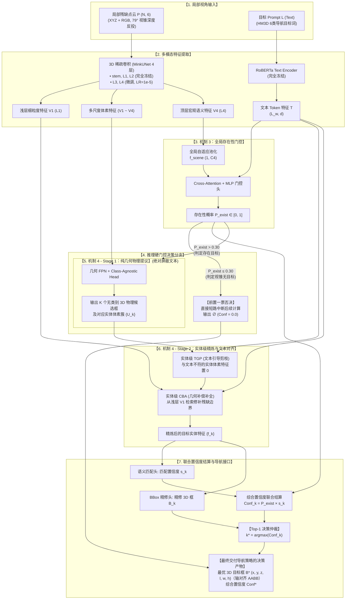
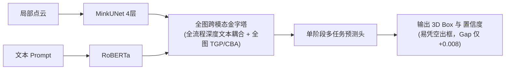
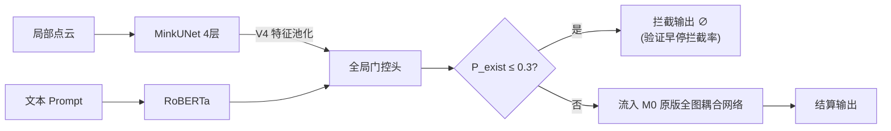
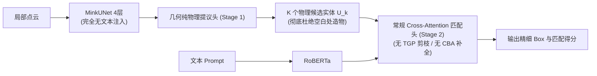
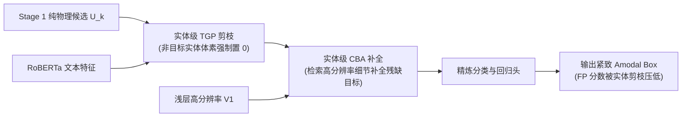

# Project VLVM: 3D Native 主动视觉语言导航系统 · Stage3
> 微调 TSP3D 使其能够真正理解局部视角

## 1. 阶段目标与背景 (Stage 3 Mission)

- **核心背景**：Stage 1 与 Stage 2 在规则层、融合层与门控层的优化已逼近工程上限。全场景评测暴露的根本瓶颈在于感知模型本身：
  - **TSP3D 检测 Precision 仅 28.41%**（3545/12477）；
  - **TP 与 FP 的置信度均值不可分（Gap 仅 +0.008，0.781 vs 0.773）**；
  - **FP 主导全场失败（占 72.2%）**，其中 84%（743 集）在真目标从未进入覆盖区时即被幻觉早停诱捕。
- **阶段使命**：放弃纯规则层打补丁，从底层彻底微调/重构 TSP3D。**坚持“推理端 100% 3D 原生”**的前提下，让 3D 识别模型在局部残缺几何、开集拒识（Rejection）与置信度区分度上具备独立支撑具身导航的能力。
- **五大机制分层体系**：划分为 **数据供给层**、**模型架构层**、**监督与蒸馏层** 三层架构。

## 2. 第一层：数据供给层（Data Feeding Layer）

> **目标**：解决全景静态扫描（3DVG 分布）与在线残缺点云（导航分布）的**几何分布漂移**，建立开集拒识的数据基础。

### 机制 1：离线模拟局部视角采样（Synthetic Local-View Slicing）
- **操作逻辑**：基于 HM3D 标注网格，使用真实相机的水平 FOV（79°）、高度（0.88m）与俯仰角，对场景执行视锥射线截断（Frustum Ray-casting）和点云下采样，合成局部残缺外壳。
- **样本设计**：显式注入未包含目标的空白视锥（走廊、白墙、杂乱死角），赋予全零真实标签（$\emptyset$）。

### 机制 2：真实探索轨迹回放采样（Rollout Trajectory Replay Sampling）
- **操作逻辑**：直接从前期已定稿的探索策略真实运行日志中，dump 智能体每一步送给 TSP3D 的真实 `wm_near_refresh_val` 融合点云与当帧观测，完全还原位姿误差、体素滑动覆盖与点云漂移伪影。
- **全量采样策略**：
  - **拒绝纯负样本偏训**：严格采集全量样本，包含真实真阳性（TP）、假阳性（FP）及完全未见目标的空场景。
  - **配比控制**：维持目标正样本与负样本比例在 **$1:2 \sim 1:3$**，既训练模型“在无目标时说 NO（输出接近 0）”的拒识能力，又避免模型坍缩为恒零预测。

## 3. 第二层：模型架构层（Model Architecture Layer）

> **目标**：彻底根除原版 TSP3D 早期全图文本剪枝引发的“文本确认偏误（Text Confirmation Bias）”，解决单输出头兼顾“几何成框 + 语义分类”导致的置信度混淆（原版 TP/FP 分数 Gap 仅 +0.008）。在推理端坚持 100% 3D 原生的前提下，实现局部残缺几何的高保真感知与极低假阳率（FP）。

### 3.1 核心机制深度定义

#### 机制 3：全局存在性门控头（Global Presence Gate）
- **特征提取与交互**：
  在 3D Sparse Backbone 顶层（`vision_backbone.layer4`）通过全局自适应池化提取场景全局 Token $f_{\text{scene}} \in \mathbb{R}^{1 \times C_4}$。将其与冻结的 RoBERTa 文本 Token $T \in \mathbb{R}^{L_w \times d}$ 进行轻量级 Cross-Attention 交叉对齐，最终经 MLP 与 Sigmoid 激活输出全局存在性先验：
  $$P_{\text{exist}} \in [0, 1] \quad (\text{当前视图点云中是否存在可观测的目标类实体})$$

- **训练与推理行为严格解耦**：
  - **推理阶段（硬门控一票否决）**：
    设定阈值 $\tau_{\text{gate}}$（机制示例取 $0.30$；**最终值 = 训练后校准量**——按 val / 在线 $P_{\text{exist}}$ 分布与“保召回”约束标定，见 §8 · 2 与 §9）。若 $P_{\text{exist}} \le \tau_{\text{gate}}$，网络**立即触发物理短路（Short-Circuit）**，跳过后续所有 Stage 1/2 的前向计算，耗时近乎为零，直接交付 $\emptyset$（$\text{Conf} = 0.0$，无有效目标框）。从源头彻底拦截 743 起因无目标盲目早停诱发的失败。
  - **训练阶段（软前向与全梯度流转）**：
    **严禁在训练期执行硬截断**。数据流无条件贯穿全网络，保证空白视锥与负样本视锥上的提议头、匹配头和 TGP 模块均能接收到梯度回传，迫使其学习“拒识”行为。

#### 机制 4：几何提议与文本判别解耦（Decoupled Geometry & 3D-Text Matching）
彻底推翻原版在主干上采样金字塔中全局依赖文本的耦合机制，重构为**两阶段原生解耦架构**：

##### 1. Stage 1：纯几何物理提议（Class-Agnostic 3D Proposal，绝对屏蔽文本）
- **物理成框（No Text Bias）**：
  3D 稀疏卷积骨干网（MinkUNet `layer1` ~ `layer4`）全尺度特征送入几何 FPN。该分支**完全屏蔽文本 Prompt**，仅依据点云的三维占据连续性、法向量一致性与几何密度聚类物理实体。
- **输出产物**：
  输出 $K$ 个无类别 3D 边界框候选（Proposals）及对应的候选局部体素簇 $\{U_k\}_{k=1}^K$。
  - **本质意义**：该阶段仅回答“此处客观存在几个物理实体”，从几何源头上彻底扼杀在空白白墙、走廊地面上“凭空造物”的幻觉。

##### 2. Stage 2：实体级精炼与文本对齐（Entity-Level Refinement & Matching）
将 Stage 1 筛出的 $K$ 个物理实体体素簇 $\{U_k\}$ 与文本特征 $T$ 进行交互，并将原版全图级 TGP/CBA 重构为**局部实体级精炼器**：
- **实体级 TGP（语义剪枝拒识）**：
  对每个候选实体 $U_k$ 内部体素与文本计算相关性。对于非目标实体（如寻找“电视”时遇到的“椅子”），**TGP 将其实体内部体素特征直接强制置 0**，在特征空间实施物理级硬拒识，强行平抑假阳性（FP）实体得分。
- **实体级 CBA（几何补偿补全）**：
  仅对 TGP 判定为目标的候选实体，从冻结的浅层高分辨率特征 $V_1$（`vision_backbone.layer1`）中检索细粒度空间占据，补全因局部单视角造成的遮挡与残缺，输出紧致的 Amodal 3D 包围盒（保证物理中心不偏移）。
- **最终结算与导航交付**：
  - 预测头输出精修 3D Box $\hat{B}_k$ 与语义匹配置信度 $s_k^{\text{match}} \in [0, 1]$；
  - 联合置信度计算：$\text{Conf}_k = P_{\text{exist}} \times s_k^{\text{match}}$；
  - **单目标决策输出**：通过 Top-1 仲裁选出最优目标：
    $$k^* = \arg\max_k \text{Conf}_k \implies \text{交付导航框架} \ \big(\hat{B}_{k^*}, \text{Conf}_{k^*}\big)$$

### 3.2 完整系统推理数据流图

以下展示在单步局部视角输入下的完整在线推理数据流：

### 3.3 实验规划：架构层阶梯式消融实验（Ablation Study）

为了严格解耦各机制的独立收益，在最佳数据层（HM3D 局部切片 + 负例注入）基底下，设立 5 档阶梯式消融矩阵：

| 档位代号 | 架构开关配置 | 核心验证目的与靶向指标 |
| :--- | :--- | :--- |
| **M0 (Baseline)** | 原版 TSP3D（文本全流程强耦合 + 全图 TGP/CBA） | 标定基准在局部切片下的原始瓶颈（验证早停数与 TP/FP Gap 极限） |
| **M1 (+Gate)** | 原版 TSP3D + **全局存在性门控头** | 验证前置“一票否决”对 743 起早停的独立拦截幅度及单头分类准确率 |
| **M2 (Decouple-Plain)** | **几何/文本两阶段解耦**（纯几何提议 + 纯文本匹配，不加 TGP/CBA） | 验证彻底切断浅层文本偏见后，候选框物理纯度的改善及对“凭空造物”的根除效果 |
| **M3 (+TGP/CBA Refine)**| 解耦架构 + **Stage 2 实体级 TGP 剪枝与 CBA 补全** | 验证实体级剪枝对混淆物体得分的压制幅度，以及 CBA 对 Amodal 完整框的几何恢复度 |
| **M4 (Full System)** | **Gate 门控 (M1) + 解耦全功能精炼架构 (M3)** | 验证双层防线协同作用下，TP/FP 置信度分离裕度（目标 Gap $\ge 0.3$）与最终导航 SR |

### 3.4 架构消融各档位数据流对比（Ablation Dataflows）

各消融档位通过对数据流分支的开启、绕行与替换，精确控制变量：

#### 1. M0 (Baseline: 原版耦合架构)

#### 2. M1 (+Gate: 原版 + 存在性门控外挂)

#### 3. M2 (Decouple-Plain: 几何成框与语义判别原生解耦)

#### 4. M3 (+TGP/CBA: 实体级硬剪枝与几何补全精炼)

#### 5. M4 (Full System: 门控一票否决 + 解耦双层防线闭环)
> 数据流完全对应 **3.2 节主系统架构图**：  
> **第一道防线**（Gate 前置硬拦截） + **第二道防线**（Stage 1 纯几何拒造物 + Stage 2 TGP 实体级硬剪枝） + **CBA Amodal 补全**，最终由门控与匹配得分乘积结算，交付 Top-1 决策产物。

## 4. 第三层：监督与蒸馏层（Supervision & Distillation Layer）

> **目标**：解决 3D 点云缺乏海量语义预训练先验的缺陷。**“训练借助 2D 海量先验，推理维持 100% 3D 原生”**。

### 机制 5：Grounding-DINO 跨模态知识蒸馏（Cross-Modal 2D-to-3D Distillation）

**前置事实（已核实）**：主数据集只落点云 + records（在线 wire 格式），RGB/depth 未落盘；但 records 逐帧保存 `{x, y, floor, yaw_deg}` 位姿 ⇒ 教师素材经 **“位姿回放侧车”** 获得，**无需重采样、主流程零改动**。

#### （1）GD 教师侧车（Teacher Sidecar）

- **做法**：按 records 逐帧位姿回放重渲 RGB(+depth)（与 `data_preprocess.py` 同源 sensor 配置：640×480、hfov 79°、高 0.88、pitch=0）→ GD 以 **6 类合并 caption 每帧一次前向** → 逐检测统计深度支撑（框内有效深度点数 `n`、中位深度 `z`）→ 落 `<dataset>/gd/{split}/<scene>.npz`（`meta_json` 指纹 + `views_json`；`views` 顺序与主 npz `offsets` 分块一致）。
- **两种产出模式**：① **一步生成** = `data_preprocess.py --gd-sidecar`（与主 npz 同遍产出）；② **后续补充** = `ft_tsp3d/gd_sidecar.py`（对已生成 npz 回放补充，支持分片 / 断点续跑）。二者产物完全同构。
- **帧条目 schema**：`{"ok": bool, "dets": [{"c": 规范类, "b": 归一化 xyxy, "s": 分数, "n": 深度支撑点数, "z": 中位深度}]}`。
- **硬规则**：**GD 失败 = 无信息，绝非负证据**（继承在线 `grounding_dino/client.py` 安全规则）⇒ 每帧带 `ok` 标志，只在 `ok=true` 帧上构建教师信号。
- **成本（估算）**：≈12 万帧（137 场景 × ~900 帧）× 0.1–0.3 s ≈ 单卡 3–9 h；侧车体积 22 MB 量级（已实测 2 场景 320 K）。

#### （2）教师质检层（统一前置过滤；仅作用于教师信号）

- **success**：只吃 `ok` 帧；
- **深度支撑**：`n ≥ n_min`（初值 40）且 `z ∈ [0.5, 5.0]` 的检测才算“有效看见”；不满足 ⇒ 不计入正证据；
- **GT 投影验证**：正样本将 GT AABB 投影至查询帧，GD 漏检（无重叠）⇒ 该视图教师项降权/失效（**用真值验证教师**，纯几何可在训练侧计算，无需图像）。
- 该质检层为**全部教师项共用**（$\mathcal{L}_{\text{gate\_dist}}$、rank′、feat），唯一维护点。

#### （3）蒸馏损失：$\mathcal{L}_{\text{gate\_dist}}$（本阶段启用）

- **本阶段启用门控软标签项**：GD 教师输出（目标类最高检出置信度，温度平滑、detach）与 TSP3D 门控输出 $P_{\text{exist}}$ 的软-BCE（见 §8 · 5）；负视锥二次压制去教师化后并入 base（§8 · 1，$\mathcal{L}_{\text{bg}}$）；rank′ / feat 为二阶段项（见（4）），届时经 $\mathbb{I}_{\text{Distill}}$ 一并接入总损失。
- **接口原则（与门控监督不冲突）**：跨模型接口只借道 gate 的简单存在性输出——不把 GD 分数对标到 TSP3D 的检测分数（两者置信度分布失配）；教师不可信样本（未过质检层）视为弃权、剔除；与 $\mathcal{L}_{\text{gate}}$ 不冲突：一致样本上梯度同向叠加，分歧样本由质检层（2）剔除。

#### （4）二阶段升级项：rank′ / feat（先记录设计）

- **排序项改写（弃“GD 分数差”原形）**：改为 **同视锥 matched↔unmatched hinge**：$\max(0, M - (S_{max}^{matched} - S_{unmatched}^{max}))$，$M = 0.30$；教师 = GD 关联的**离散信号**（无分数刻度问题），只在 label=1 且有匹配的视图激活（视图级 max 单对）；关联必须过 **3D 核验**（复用 `grounding_dino/region.py` 反投影 + `boxes.py` 的 `iau_3d`/`containment`），2D IoU 仅作预筛；激活率与 λ 待侧车统计确认。
- **特征蒸馏**：需教师特征导出（现 GD 包装只吐 boxes/logits/phrases；建议取“检测对应 decoder query token” 256-d，免 RoIAlign）；实现量最大，A/B 排最后。

#### （5）开关、消融矩阵与判定指标

- **开关**：损失面共四个消融开关 $\mathbb{I}_{\text{Gate}} / \mathbb{I}_{\text{Prop}} / \mathbb{I}_{\text{Refine}} / \mathbb{I}_{\text{Distill}}$（base 恒定生效、不参与消融；$\mathbb{I}_{\text{neg}}$ 已取消——$\mathcal{L}_{\text{bg}}$ 并入 base）；GD 侧车为蒸馏项（$\mathcal{L}_{\text{gate\_dist}}$）的训练期必需输入；推理端本就无教师（蒸馏天然 train-only）。
- **消融矩阵**：base 之上按开关组合（建议顺序：gate → s2 → s1 → distill）。
- **本轮判定指标**：假阳性早停拦截率 / 门控召回（GT 存在视图开闸率）/ 误关率 + SR；**Gap 归二阶段**；$\tau_{\text{gate}}$ 各组权重独立后校准。
- **在线推理阶段（不变）**：完全下线 GD，导航全流程仅依赖微调后的纯 3D TSP3D 前向，保持零 2D 开销。

## 5. 机制归纳与全景路线图

| 层次 | 机制名称 | 核心性质 | 靶向解决的 Stage2 缺陷 | 实验验证模式 |
| :--- | :--- | :--- | :--- | :--- |
| **数据供给层** | **离线模拟局部视角采样** | 纯几何模拟 | 静态整屋与局部视野的视锥截断漂移 | 与真实回放做 **A/B 测试** |
| | **真实探索轨迹回放采样** | 在线回放（正负全量） | 真实 SLAM / 时序融合伪影与严重缺乏负样本 | |
| **模型架构层** | **全局存在性门控头** | 网络输出头补丁 | 局部点云无目标时盲目打高分（743 起早停） | 标准四档 **消融实验** （M0 $\to$ M1 $\to$ M2 $\to$ M3） |
| | **几何提议与文本判别解耦** | 骨干网络重构 | 浅层 TGP 导致的无中生有/文本确认偏误 | |
| **监督与蒸馏层** | **Grounding-DINO 跨模态蒸馏** | 训练期跨模态对齐 | 3D 语义辨识力弱、TP/FP 置信度差仅 +0.008 | **A/B 测试**（本阶段：门控蒸馏；二阶段：rank′ / feat 单变量，见 §4） |

## 6. 数据供给层 实验规划

* **场景**：
  - **划分 9:1（场景级留出，固定 seed，冻结于 `splits.json`）**：**训练 123 场景 / 检验 14 场景**；
  - **20 个 nav 场景**：只用于在线测试，**不生成任何合成数据**。
* **机制 1 数据预处理**（`ft_tsp3d/data_preprocess.py`）：
  - **仿真**：独立 habitat_sim（COLOR + DEPTH + SEMANTIC，RGB 必需，否则语义图恒全零）；640×480、hfov 79°、传感器高度 0.88 m、pitch=0；深度 = 平面 z 深度，先按在线公式 `norm=(d−0.5)/4.5` 再走同款 `filter_depth`，反投影 `pts_base=[d,−xc,−yc]`、`fx=fy=390.4`；几何约定经标定验证（目标类 AABB 包含率 **100%@+0.10 m**、同点旋转 40° 跨视角点云 NN 中位 **0.013 m**）。
  - **采样**：导航网格随机可达点 + 均匀 yaw；每视图 = K~U(1,8) 帧短轨迹（连续帧须跨 0.15 m / 15° 去重门，含原地旋转观测），查询位姿 = 末帧。
  - **融合 / 发送**：复用在线 `TSP3DInputPreprocessor`（world 路线：体素 0.02 / 半径 6.0 / 8 帧窗 / near_refresh 3.0=True；发送侧 distance_sample 1.5–3.0 m→0.01/0.02/0.05 + cap 200k random）；点云 **float16**（= 在线 wire dtype）。
  - **文本 / 标签**：目标词表 = 框架 6 类 `chair / bed / potted plant / toilet / tv / couch`，原始语义名经 `grounding_dino/vocab.py` 的 alias/单复数归一（多词变体不映射）；正样本 = 查询类可见（像素 ≥40）且云内目标点 ≥40，GT = **完整实例 AABB**（canonical 系轴对齐重包裹）；负样本 = 从 6 类随机取「视图内该类的所有实例像素均 $< \text{min\_vis\_px}(40)$（弱可见 $1\sim39$ px 或完全不可见）」的规范类（**存在 / 不存在以 `min_vis_px` 为统一阈值**，不要求严格 0 像素）；**全局正负配比 1:3**。
  - **截断规则**：`trunc = 1 − 目标 AABB 表面采样点落入 K 帧任一视锥（深度 ∈[0.5,5.0] m）的比例`；`> 0.85` 直接剔除（仅记 `dropped.jsonl`）、`0.70–0.85` 记 `weight=0.5`、其余 `weight=1.0`；负样本不受影响。
  - **产物**（`data/ft_datasets/local_view/`）：`{train,val}/<scene>.npz`（`points` float16 + `offsets` + `records_json`；同一视图的正/负样本共享一份点云）+ `splits.json` / `stats.json` / `dropped.jsonl`。
  - **（GD 教师侧车 · 09-26 新增）**：按 records 逐帧位姿回放重渲 RGB(+depth)（同源 sensor 配置）→ GD 6 类合并 caption 每帧一次前向 → 落 `<dataset>/gd/{split}/<scene>.npz`（`meta_json` + `views_json`；帧条目 = `ok` + 检测 `{c, b, s, n, z}`）。两种产出模式：① 一步生成 = `data_preprocess.py --gd-sidecar`（与主 npz 同遍）；② 后续补充 = `ft_tsp3d/gd_sidecar.py`（对已生成 npz 回放，支持分片/续跑）。硬规则：GD 失败 = 无信息（`ok=false` 帧不视作负证据，训练侧跳过）。成本估算：≈12 万帧 × 0.1–0.3 s ≈ 单卡 3–9 h。
  - **（标签面 · 仅 $\mathcal{L}_{s1}$ 依赖）逐场景实例 AABB 表**：$\mathcal{L}_{s1}$ 需要“非目标实体”的标签面（可见实体表 / 实例表；生成期已计算 `inst_px`/`cls_px`，未落盘）。**09-26 收敛：现数据集可训、不再暂缓**——轻量补法 = 逐场景加载 sim 静态导出实例 AABB 表（分钟级、非重跑），训练侧用几何归属（提议簇点集 ↔ 实例 AABB）给出标签；不影响 $\mathcal{L}_{\text{base}}$ / $\mathcal{L}_{s2}$（后者 TGP 掩码已改为几何包含判定，零新增数据）。更重路线（侧车重放重建可见实体表 / 扩 schema 落盘逐点语义 id）见 §10 保留项。
  - **实测参考**：≈0.6 s/尝试（K≈4.2）、≈34 k 点/视图、≈0.185 MB/视图（压缩）⇒ 137 场景 × 200 视图约 **5 GB**、单进程约 12 h。
* **测试（直接进框架在线评测，不另设独立离线测试）**：
  - 微调权重直接进导航框架在线评测（`scripts/my_eval.sh hm3d`，20 场景 / 2000 集）；
  - 判定：SR / Oracle / spl / soft_spl 与假阳性早停数（对照 Stage 2 定稿全量 0.3875 / Oracle 0.4020）。
* **机制 2（补充机制，本轮不实现）**：
  - 定位：机制 1 判定不足时的叠加项（真实探索轨迹回放采样）；
  - 原设计保留（回放采集 / TP、FP 全量 / 正负配比 1:2~1:3），实现待启动。

## 7. 优化器、微调策略与学习率（经验设置）

### 模块级微调与参数适配策略

| 架构层级 | 对应具体模块 | 参数更新策略 | 核心设计考量 |
| :--- | :--- | :--- | :--- |
| **3D 几何骨干（浅层）** | `vision_backbone` stem（`conv1`/`norm1`/`maxpool`）+ `layer1`/`layer2` | **完全冻结（Freeze, LR = 0）** | 提取底层物理占据、表面连续性与法向特征，全景与局部物理同构，严禁改动 |
| **3D 几何骨干（深层）** | `vision_backbone.layer3` / `layer4` | **深层微调（Low LR, $1 \times 10^{-5}$）** | 仅微调顶层高阶空间语义，使其平滑适配局部残缺几何输入 |
| **文本骨干网络** | RoBERTa Text Encoder（`data/tsp3d_models/` 本地权重） | **完全冻结（Freeze, LR = 0）**（代码已内建：`bdetr.py` `requires_grad=False`） | 查询文本已退化为 6 个固定类词（HM3D ObjectNav），微调只会对这 6 词过拟合；同时保护 ScanRefer 预训练建立的文本-几何对齐（与场景数无关） |
| **跨模态精炼模块** | Stage 2 精炼器（现版 = `head.keep_conv/keep_trans/com_trans/com_cls`；M2 解耦架构落地后为实体级 TGP/CBA） | **全量微调（Full Fine-Tune，并入组 2）** | 解耦后该模块承担实体级新角色（查询集与输入分布改变），需要完整可塑性完成适配；模块仅 ≈2.0 M 参数（全模型 ≈141.5 M），低秩参数化无训练规模收益，其漂移控制由 RoBERTa / 浅层骨干冻结与组内小 LR 承担 |
| **新增任务预测头** | 全局门控头、Stage 1 提议头、打分头 | **全量微调（Base LR）** | 全新引入的功能分支，无历史参数包袱，全量放开以快速学习局部判别与前置拦截 |

### 优化器设定与分立学习率配置

模型采用单一优化器承载多参数组（Parameter Groups）的分立学习率策略，确保深浅层更新幅度严格解耦：

- **优化器选型**：`AdamW`
  - 动量参数：$\beta_1 = 0.9, \ \beta_2 = 0.999$
  - 数值稳定性常数：$\epsilon = 1 \times 10^{-8}$
  - 权重衰减（Weight Decay）：$1 \times 10^{-4}$

- **参数组分级初始学习率（Initial LR，09-25 经验定稿）**：
  - **组 1（新增任务头）**：$1 \times 10^{-4}$（全局门控头 / Stage 1 提议头 / 打分头；驱动局部判别能力快速建立）；
  - **组 2（跨模态交互与发送侧适配层）**：$5 \times 10^{-5}$（`text_projector` + `head.keep_conv/keep_trans/com_trans/com_cls/pos_embed`；M1/M2/M3 落地后实体级 TGP/CBA 全量并入本组）；
  - **组 3（3D Backbone 顶层卷积）**：$1 \times 10^{-5}$（`vision_backbone.layer3/layer4`；取区间下界，历史 V1 全放开 $1\times10^{-4}$/3 ep 曾致 tp 崩）；
  - **未激活组（stem + `layer1/layer2` + RoBERTa）**：不进入优化器参数列表（`param.requires_grad = False`）。
  - 历史锚点：prune 档（25 可训参数）$5\times10^{-5}$、1 ep 为安全档；old 管线其余超参（`bs=1`、`wd=5\times10^{-4}$）已被下表取代。

- **权重衰减分组（09-25 定稿）**：统一 `AdamW wd = 1e-4`（对齐 DETR / Grounding DINO，取代旧管线 $5\times10^{-4}$）；另设 `wd = 0` 参数组：所有 `*norm*` / `*.bn.*` / `bias` / `pos_embed`（DETR 系惯例）。

- **训练规模与调度（09-25 定稿）**：总 **3 Epoch**（train 123 场景 × 200 视图 ≈ 24.6 k 样本/epoch，`bs=1` ⇒ `T_max` 按剩余 2 epoch 的总步数折算）；第 1 epoch 内所有参数组从 $1 \times 10^{-6}$ 线性 warmup 至各自目标 LR；自第 2 epoch 起全组同步 `CosineAnnealingLR` 退火，`eta_min = 1 \times 10^{-6}$。

### 学习率动态调度机制

- **预热阶段（Linear Warmup）**：
  - 在第 1 个 Epoch 内，所有参数组的学习率从 $1 \times 10^{-6}$ 线性增加至各自设定的目标初始学习率，避免初始随机梯度冲垮深层特征。
- **衰减阶段（Cosine Annealing）**：
  - 自第 2 个 Epoch 起，全参数组同步遵循余弦退火曲线（`CosineAnnealingLR`）递减；
  - 最终学习率底线（Eta-Min）统一锚定在 $1 \times 10^{-6}$。
- **数值与梯度稳定性保障（Gradient Clipping）**：
  - 在每一步反向传播求导完成后、优化器步进前，实施严格的全局梯度范数截断：
    $$\|\mathbf{g}\| \le \text{max\_norm} = 0.1$$
  - 该设置严格对齐 DETR 与 Grounding DINO 规范，防止小 Batch 点云计算中出现的瞬时异常极大梯度。

## 8. 全任务联合损失总函数与架构开关

损失函数由**五部分**组成——`base / gate / s1 / s2 / distill`：base **恒定生效（不参与消融，内部含 $\mathcal{L}_{\text{bg}}$）**，其余四项由消融开关启闭：

$$\mathcal{L}_{\text{total}} = \mathcal{L}_{\text{base}} + \mathbb{I}_{\text{Gate}} \cdot \lambda_{\text{gate}} \mathcal{L}_{\text{gate}} + \mathbb{I}_{\text{Prop}} \cdot \lambda_{s1} \mathcal{L}_{s1} + \mathbb{I}_{\text{Refine}} \cdot \lambda_{s2} \mathcal{L}_{s2} + \mathbb{I}_{\text{Distill}} \cdot \lambda_{\text{distill}} \mathcal{L}_{\text{distill}}$$

- **五部分结构**：1) **base（恒定）** = $\mathcal{L}_{\text{cls\_base}}$（ASL）+ $\mathcal{L}_{\text{l1\_base}}$ + $\mathcal{L}_{\text{giou3d\_base}}$ + **$\mathcal{L}_{\text{bg}}$（负视锥二次压制）**；2) **gate（$\mathbb{I}_{\text{Gate}}$）**；3) **s1（$\mathbb{I}_{\text{Prop}}$）**；4) **s2（$\mathbb{I}_{\text{Refine}}$）**；5) **distill（$\mathbb{I}_{\text{Distill}}$）** = 本阶段：门控软标签蒸馏 $\mathcal{L}_{\text{gate\_dist}}$（§8 · 5；教师 = GD 侧车）；二阶段扩 rank′ / feat；
- **现数据集可训集合（09-26 收敛）**：$\mathcal{L}_{\text{base}}$（含 $\mathcal{L}_{\text{bg}}$，零新增数据）、$\mathcal{L}_{\text{gate}}$（标签 = records 的 `label`，见下节 2）、$\mathcal{L}_{s1}$（标签面 = 逐场景实例 AABB 表：轻量导出、非重跑，见 §6）、$\mathcal{L}_{s2}$（含体素级几何掩码版 $\mathcal{L}_{\text{tgp\_s2}}$）与 $\mathcal{L}_{\text{distill}}$（本阶段 = $\mathcal{L}_{\text{gate\_dist}}$，教师 = GD 侧车）均可训练（base 恒定；gate / s1 / s2 / distill 四项随消融开关控制）；
- **基准平衡权重**：$\lambda_{\text{gate}} = 1.0, \quad \lambda_{s1} = 1.0, \quad \lambda_{s2} = 1.0$；base 内部系数 $\lambda_{\text{l1}} = \lambda_{\text{giou}} = \lambda_{\text{bg}} = 1.0$；$\lambda_{\text{distill}} = 1.0$（本阶段仅门控软标签项）；
- **内部子项基准系数**（首轮统一 1.0，若出现单项量级主导再按实测平衡）：$\lambda_{\text{box1}} = \lambda_{\text{giou1}} = 1.0$；$\lambda_{\text{box2}} = \lambda_{\text{giou2}} = \lambda_{\text{tgp}} = 1.0$；
- **预测槽位 $K$**：$\mathcal{L}_{\text{base}}$ / $\mathcal{L}_{s1}$ / $\mathcal{L}_{s2}$ 的求和槽位数 = 最终输出的候选框数；M2/M3/M4 档 = Stage 1 提议数，M0/M1 档沿用原版单候选路径（`nms_pre=1` ⇒ $K=1$）。

### 1. 终局任务底座损失：$\mathcal{L}_{\text{base}}$（恒定生效，含 $\mathcal{L}_{\text{bg}}$）

> **定位**：无论内部架构如何消融（M0 到 M4），$\mathcal{L}_{\text{base}}$ **始终生效**（不参与消融），直接监督网络最终交付给导航决策的 Top-1 预测产物与真实 3D GT 之间的误差；并恒常携带 $\mathcal{L}_{\text{bg}}$（负视锥二次压制）。

$$\mathcal{L}_{\text{base}} = \mathcal{L}_{\text{cls\_base}} + \mathbb{I}(y_{\text{exist}} = 1) \cdot \Big( \lambda_{\text{l1}} \mathcal{L}_{\text{l1\_base}} + \lambda_{\text{giou}} \mathcal{L}_{\text{giou3d\_base}} \Big) + \lambda_{\text{bg}} \mathcal{L}_{\text{bg}}$$

- **$\mathcal{L}_{\text{cls\_base}}$（终端置信度损失，独占 ASL）**：
  $$\mathcal{L}_{\text{cls\_base}} = \frac{1}{K} \sum_{k=1}^K \ell_{\text{asl}}(p_k, \hat{y}_k)$$
  $$\ell_{\text{asl}}(p_k, \hat{y}_k) = \begin{cases} 
  - (1 - p_k)^{\gamma_+} \log(p_k + \epsilon), & \text{若 } \hat{y}_k = 1 \\ 
  - (p_k)^{\gamma_-} \log(1 - p_k + \epsilon), & \text{若 } \hat{y}_k = 0 
  \end{cases}$$
  - **参数**：$\gamma_+ = 1.0, \ \gamma_- = 4.0$；
  - **标签 $\hat{y}_k$ 与匹配口径**：匹配 = 提议与视锥内真目标 GT AABB 的匈牙利匹配（成本 $= 1 - \text{IoU}_{\text{3D}}$）；若视锥包含真目标（$y_{\text{exist}}=1$），匹配上的唯一项赋 $\hat{y}_{k^*} = 1$，**其余（含与目标高重叠的重复提议）全部赋 0**；若视锥无目标（$y_{\text{exist}}=0$），所有 $K$ 项全部赋 0。
- **$\mathcal{L}_{\text{l1\_base}}$（3D 边界框物理对齐，轴对齐 AABB，无 Yaw）**：
  仅对正样本 $k^*$ 计算（框为 canonical 系轴对齐 6 元组 $(x, y, z, l, w, h)$，与数据层 GT、头输出维度、在线消费口径一致；yaw 项已收敛删除，见 §9）：
  $$\mathcal{L}_{\text{l1\_base}} = \underbrace{\|\hat{c}_{k^*} - c^{\text{gt}}\|_1}_{\text{中心位置}} + \underbrace{\|\log(\hat{\mathbf{d}}_{k^*}) - \log(\mathbf{d}^{\text{gt}})\|_1}_{\text{尺寸对数尺度}}$$
- **$\mathcal{L}_{\text{giou3d\_base}}$（终局 3D GIoU 空间包络损失）**：
  $$\mathcal{L}_{\text{giou3d\_base}} = 1 - \text{GIoU}_{\text{3D}}(\hat{B}_{k^*}, B^{\text{gt}})$$
- **$\mathcal{L}_{\text{bg}}$（负视锥二次压制；base 恒常组件）**：
  > 原蒸馏提案 $\mathcal{L}_{\text{bg}}$ 的去教师化版本（09-26 收敛）。目标由真值标签完全定义（负视锥 ⇒ 全部候选分数 → 0），不再挂 GD 条件——教师条件只会缩小覆盖，且删掉的恰是“2D 被诱惑、3D 必须拒绝”的硬负例。
  $$\mathcal{L}_{\text{bg}} = \mathbb{I}(y_{\text{exist}} = 0) \cdot \frac{1}{K} \sum_{k=1}^{K} (s_k)^2$$
  - **梯度形态与分工**：二次型对中段分数（0.3–0.7）压制强（$p=0.5$ 处梯度 $2p = 1.0$），而 ASL $\gamma_- = 4$ 在 $p < 0.3$ 的负样本梯度仅 $\sim 10^{-2}$ 量级 ⇒ 两者作用面互补：ASL 集中压制高分端（743 早停诱因），$\mathcal{L}_{\text{bg}}$ 覆盖中段“分数堆积”型幻觉；
  - **口径**：×record `weight`（负样本恒 1.0）；reduction = 批内均值；$K$ = 候选槽位数（仅 M2+ 档 $K>1$ 时有实际作用）；
  - **生效方式**：随 base 恒常生效（不设独立顶层开关）；无教师依赖（GD 侧车关闭时照常生效）。

### 2. 全局存在性门控损失：$\mathcal{L}_{\text{gate}}$（Presence Gate Loss；消融：$\mathbb{I}_{\text{Gate}}$）

> **定位**：监督门控头（`layer4` 全局池化 Token × 文本 Token 的 Cross-Attention + MLP）输出的 $P_{\text{exist}} = \sigma(z_{\text{gate}})$。**标签与现数据集直接兼容**：$y_{\text{exist}}$ = records 的 `label`，无需新增数据。

$$\mathcal{L}_{\text{gate}} = - \alpha_{\text{gate}} (1 - P_{\text{exist}})^{\gamma} y_{\text{exist}} \log(P_{\text{exist}} + \epsilon) - (1 - \alpha_{\text{gate}}) P_{\text{exist}}^{\gamma} (1 - y_{\text{exist}}) \log(1 - P_{\text{exist}} + \epsilon)$$

- **标签口径（与 §6 统一）**：$y_{\text{exist}} = \text{record 的 } \texttt{label}$；“存在” = 查询类在本视图内**任一实例像素 $\ge$ `min_vis_px`(40)**；“不存在” = 该类所有实例像素 $< 40$（弱可见 $1\sim39$ px 或完全不可见）；负样本池含“类存在于场景、但本视图不可见”——正是 743 起早停的同分布硬负例；且取“任一实例”判定 ⇒ 不受单实例标注残差影响；
- **超参数（首轮基准）**：$\gamma = 2.0$、$\epsilon = 10^{-6}$；$\alpha_{\text{gate}}$ 按“精确抵消样本配比”的闭式取 $\alpha_{\text{gate}} = n_{\text{neg}}/(n_{\text{pos}} + n_{\text{neg}})$（设计配比 1:3 ⇒ $0.75$）；生成完成后按 `stats.json` 实测 pos/neg 复核；
- **样本权重与归约**：乘 record 的 `weight`（高截断正样本记 0.5，与其它损失同口径；负样本恒 1.0）；reduction = 批内均值；
- **梯度边界（属“训练/推理严格解耦”的一部分）**：交付侧 $Conf_k = P_{\text{exist}} \times s_k$ 的乘子在训练期对 $P_{\text{exist}}$ **停止梯度（detach）**——切断的是框损失（ASL / 匹配）经乘子对 $P_{\text{exist}}$ 的耦合；门控头由 $\mathcal{L}_{\text{gate}}$（真值监督）+ $\mathcal{L}_{\text{gate\_dist}}$（教师蒸馏，§8 · 5）双源监督（二者不冲突，见 §8 · 5），保证 $\tau_{\text{gate}}$ 可离线校准；推理期照常相乘；
- **阈值**：$\tau_{\text{gate}}$ 不在训练目标内，属**训练后校准量**（机制示例值 0.30，见 §3.1 / §9）；
- **边界（记录）**：“可见但云内目标点 $<40$”的（视图, 类）对在生成期整体剔除（既非正也非负）⇒ 门控不覆盖“稀疏可见”情形；如需覆盖（忽略带 / 降级负样本）另行决策，当前与数据规则保持一致；
- **训练期行为**：软前向、严禁硬截断（与 §3.1 一致）。

### 3. Stage 1 纯几何提议损失：$\mathcal{L}_{s1}$（消融：$\mathbb{I}_{\text{Prop}}$）

> **定位**：完全屏蔽文本。从局部残缺点云中提取 $K$ 个“客观存在的物理候选框”及其物体性。

$$\mathcal{L}_{s1} = \mathcal{L}_{\text{obj\_s1}} + \mathbb{I}(N_{\text{gt\_obj}} > 0) \cdot \Big( \lambda_{\text{box1}} \mathcal{L}_{\text{box\_s1}} + \lambda_{\text{giou1}} \mathcal{L}_{\text{giou3d\_s1}} \Big)$$

- **$\mathcal{L}_{\text{obj\_s1}}$（纯几何物体性损失，采用标准 Focal Loss）**：
  $$\mathcal{L}_{\text{obj\_s1}} = \frac{1}{K} \sum_{k=1}^K \text{FL}(p_k^{\text{obj}}, \hat{y}_k^{\text{obj}})$$
  $$\text{FL}(p, y) = - \alpha (1 - p_t)^\gamma \log(p_t), \quad p_t = y \cdot p + (1 - y)(1 - p)$$
  - **参数**：$\alpha = 0.5, \ \gamma = 2.0$；
  - **行为与匹配口径**：$\hat{y}_k^{\text{obj}}$ 由提议与视锥内**可见实体的 GT AABB** 做匈牙利匹配（成本 $= 1 - \text{IoU}_{\text{3D}}$）给出，$N_{\text{gt\_obj}}$ = 匹配上的实体数；在多物体视锥中匹配所有物理实体；在空白视锥（白墙）中所有 $\hat{y}_k^{\text{obj}} = 0$，将物体性压制趋向于 0。
  - **当前状态（09-26 收敛）**：**现数据集可训**——标签面 = 逐场景实例 AABB 表（轻量导出，分钟级、非重跑，§6）＋训练侧几何归属；随消融开关 $\mathbb{I}_{\text{Prop}}$ 控制（默认开启）。
- **$\mathcal{L}_{\text{box\_s1}}$（粗糙几何物理框 L1 回归，无 Yaw 对齐）**：
  $$\mathcal{L}_{\text{box\_s1}} = \frac{1}{N_{\text{pos1}}} \sum_{k \in \mathcal{P}_{\text{pos1}}} \Big( \|\hat{c}_k - c_k^{\text{gt}}\|_1 + \|\log(\hat{\mathbf{d}}_k) - \log(\mathbf{d}_k^{\text{gt}})\|_1 \Big)$$
- **$\mathcal{L}_{\text{giou3d\_s1}}$（粗框 3D GIoU 空间重叠约束）**：
  $$\mathcal{L}_{\text{giou3d\_s1}} = \frac{1}{N_{\text{pos1}}} \sum_{k \in \mathcal{P}_{\text{pos1}}} \Big( 1 - \text{GIoU}_{\text{3D}}(B_k^{\text{prop}}, B_k^{\text{gt}}) \Big)$$

### 4. Stage 2 实体精炼与匹配损失：$\mathcal{L}_{s2}$（消融：$\mathbb{I}_{\text{Refine}}$）

> **定位**：在纯几何提议簇 $\{U_k\}$ 上引入文本交互。通过 TGP 实体体素剪枝压制非目标，通过 CBA 补全 Amodal 框。

$$\mathcal{L}_{s2} = \mathcal{L}_{\text{match\_s2}} + \mathbb{I}(y_{\text{exist}} = 1) \cdot \Big( \lambda_{\text{box2}} \mathcal{L}_{\text{box\_s2}} + \lambda_{\text{giou2}} \mathcal{L}_{\text{giou3d\_s2}} \Big) + \mathbb{I}_{\text{TGP}} \cdot \lambda_{\text{tgp}} \mathcal{L}_{\text{tgp\_s2}}$$

- **$\mathcal{L}_{\text{match\_s2}}$（中间实体匹配置信度，采用 Focal Loss）**：
  $$\mathcal{L}_{\text{match\_s2}} = \frac{1}{K} \sum_{k=1}^K \text{FL}(p_k^{\text{match}}, \hat{y}_k^{\text{match}})$$
  - **参数**：$\alpha = 0.25, \ \gamma = 2.0$（处理候选正负失衡，保障中间特征平滑流转）；
  - **匹配口径**：与 $\mathcal{L}_{\text{base}}$ 相同（提议 ↔ 文本真目标的匈牙利匹配，成本 $= 1 - \text{IoU}_{\text{3D}}$），仅匹配项 $\hat{y}_{k^*}^{\text{match}} = 1$。
- **$\mathcal{L}_{\text{box\_s2}}$ 与 $\mathcal{L}_{\text{giou3d\_s2}}$（精修框空间回归，无 Yaw 对齐）**：
  - 仅对匹配到文本真目标的提议计算，中心位置与尺寸对数 L1 + 3D GIoU：
    $$\mathcal{L}_{\text{box\_s2}} = \|\hat{c}_{k^*} - c^{\text{gt}}\|_1 + \|\log(\hat{\mathbf{d}}_{k^*}) - \log(\mathbf{d}^{\text{gt}})\|_1$$
    $$\mathcal{L}_{\text{giou3d\_s2}} = 1 - \text{GIoU}_{\text{3D}}(\hat{B}_{k^*}^{\text{refine}}, B^{\text{gt}})$$
- **$\mathcal{L}_{\text{tgp\_s2}}$（TGP 体素剪枝显式监督，采用 BCE；体素级几何掩码）**：
  $$\mathcal{L}_{\text{tgp\_s2}} = \frac{1}{K} \sum_{k=1}^K \frac{1}{|U_k|} \sum_{v \in U_k} \text{BCE}\Big( M_k(v), M_k^*(v) \Big)$$
  - 掩码 $M^*$ 由**几何包含判定**给出：体素落在目标实例 GT AABB 内（含 `box_margin`=0.05 m，与数据层 `target_pts` 同一判定）⇒ 1，否则 ⇒ 0；无目标视图（$y_{\text{exist}}=0$）全部置 0。**不经过“簇→实体归属”步骤**，可用现有产物（npz 点云 + records 目标 AABB）直接计算；
  - 语义：跨实体 / 贴墙的混合簇自动获得逐体素的 0/1 混合信号（不会整簇翻转）；非目标实体簇的体素天然在目标 AABB 外 ⇒ 全 0（拒识目标不变）；
  - **簇级等权归一化**：先簇内平均、再跨簇平均 ⇒ 每个提议对损失的权重相同，避免大簇按体素数放大占比；
  - **实现边界**：现有 `forward_test` 的剪枝掩码在 `torch.no_grad()` 内计算、`MinkowskiPruning` 不可导 ⇒ 现成 `keep_conv`/`com_cls` 通路无梯度；本损失的梯度通路须随 M2/M3 的实体级前向重建。

### 5. 蒸馏损失：$\mathcal{L}_{\text{distill}}$（消融：$\mathbb{I}_{\text{Distill}}$）

> **定位**：蒸馏机制（§4）在损失面上的接入点。**本阶段启用门控软标签项 $\mathcal{L}_{\text{gate\_dist}}$**（教师 = GD 侧车输出；学生 = 门控输出 $P_{\text{exist}}$）；二阶段扩 rank′ / feat（见 §4（4））。

$$\mathcal{L}_{\text{gate\_dist}} = - \hat{Y}_{\text{GD}} \log(P_{\text{exist}} + \epsilon) - (1 - \hat{Y}_{\text{GD}}) \log(1 - P_{\text{exist}} + \epsilon), \qquad \hat{Y}_{\text{GD}} = \sigma\!\Big(\frac{\mathrm{logit}(S^{\max}_{2D})}{T}\Big)$$

- **教师信号**：$S^{\max}_{2D}$ = 该视图 GD 对目标类的最高检出置信度（无检出取 0）；$T = 1.5$ 温度平滑（防极端偶发误检）；$\hat{Y}_{\text{GD}}$ 严格 detach；仅 `ok` 帧 + 深度支撑（$n \ge 40$、$z \in [0.5, 5.0]$）+ GT 投影验证通过后参与（§4（2））；
- **与 $\mathcal{L}_{\text{gate}}$ 不冲突**：两者作用于同一 $P_{\text{exist}}$——真值硬标签（加权 Focal）+ 教师软标签（软-BCE）双源监督；一致样本梯度同向叠加，分歧样本由质检层剔除；蒸馏补的是稀疏 / 远端视图上真值 0/1 之外的平滑先验；
- **梯度边界**：$\hat{Y}_{\text{GD}}$ 侧 detach；框损失经 $Conf_k$ 乘子对 $P_{\text{exist}}$ 的路径已切断 ⇒ $P_{\text{exist}}$ 的梯度仅来自 $\mathcal{L}_{\text{gate}} + \lambda_{\text{distill}} \mathcal{L}_{\text{gate\_dist}}$，保证 $\tau_{\text{gate}}$ 可离线校准；
- **数据依赖**：GD 侧车（§4（1））为训练期必需输入；推理端无教师（蒸馏天然 train-only）。

## 9. 核心设计成因深度剖析

### 轴对齐口径（Yaw 收敛）与 ASL 归属的架构定稿

1. **Yaw（偏航角）项已收敛删除，全链统一为轴对齐 AABB**：
   - 数据层 GT 为 canonical 系轴对齐重包裹（无 yaw 字段，$\theta_{\text{gt}} \equiv 0$）、头输出为 6 元组（`n_reg_outs=6`、`box_dim=6, with_yaw=False`）、仓库 3D IoU/GIoU 为轴对齐实现（入参 $x_1y_1z_1x_2y_2z_2$）——“含 yaw 的框”与“轴对齐 GIoU”不能同时成立；
   - 在线链路（记忆条目、近表面点、PointNav 的 $(\rho,\theta)$）均不消费 box yaw ⇒ 训练 yaw 无落地收益；Stage 1/2 作为中间候选生成器本就无角度监督；
   - 交付物 = 轴对齐 6 元组 $(x, y, z, l, w, h)$。
2. **ASL 仅用于 $\mathcal{L}_{\text{base}}$ 的最终置信度，$\mathcal{L}_{s1}$ 与 $\mathcal{L}_{s2}$ 均使用 Focal Loss**：
   - 两类损失的差别是**负样本权重的锐度**（Focal $\gamma=2$ 的 $p^2$ vs ASL $\gamma_-=4$ 的 $p^4$），不是“平滑 vs 硬截断”的两种机制；中间层取 $\gamma=2$ 以保持平稳的负样本权重分布，避免更新被少数高分负样本支配；
   - 最终输出头（$\mathcal{L}_{\text{base}}$）直接决定 Habitat 智能体是否触发早停动作（原版 743 起早停失败的直接诱因），故将负样本权重最集中于高分端的配置放在终端出口，目标是在检测级拉开 TP/FP 分布（Gap $\ge 0.3$ 为期望值）。

### 为什么 Base 的置信度损失使用 Asymmetric Loss (ASL)？
- **直击核心失败源**：全场景评测暴露的致命瓶颈在于 **TSP3D 的 TP 与 FP 均值不可分（Gap 仅 +0.008，0.781 vs 0.773）**，其中 743 集失败完全是因为模型在没看到目标时给出 $0.77$ 的高分诱发早停。
- **ASL 的机制（与 Focal 同族的重加权，非“更陡的梯度”）**：
  - 负样本项与 Focal Loss 同形：$-(p)^{\gamma_-} \log(1-p)$。$\gamma_-: 2 \to 4$ 的效果是**把负样本权重分布更集中于高分端**（易负样本 $p \approx 0.05$ 的权重从 $\approx 2.5\times10^{-3}$ 压到 $\approx 6\times10^{-6}$；$p=0.7$ 处权重 $0.24$），而不是产生比 BCE 更大的绝对梯度（$p=0.7$ 处 ASL 梯度 $\approx 0.52$ vs BCE $0.70$；$p=0.9$ 处 $\approx 1.20$ vs $0.90$，同量级）；
  - 正样本用 $\gamma_+ = 1.0$（相对 $\gamma_+ = 2$ 更宽松），保持真目标的高分表达；
  - **边界**：ASL 不含显式 margin 项、不改变特征可分性 ⇒ 它只能“重加权”地把高置信负样本的评分压下来；Gap $\ge 0.3$ 是**期望值而非数学保证**。且 Gap 是在线分布上的检测级读数（§1），微调后需按实际检测级分布复核下游 $\sigma_{\text{tar}} = 0.70$ 准入线的兼容性（评测侧校准）。

### 为什么 $\mathcal{L}_{s1}$ 和 $\mathcal{L}_{s2}$ 的置信度不使用 ASL，而使用 Focal Loss？

这取决于**中间阶段（Intermediate Stages）与终端决策（Final Decision）在优化动力学上的分工**：

#### (1) Stage 1 必须严守“高召回率（High Recall）”原则
- 与损失元素相关的配比是「**提议槽位数 $K$ : 命中实体数**」（$K$ 远大于正样本数）；数据集层面的视图配比（$1:3$，§6）不是这里的相关量。
- 负样本权重锐度（$\gamma_-$：$2 \to 4$）改变的是梯度预算分配：$\gamma_- = 4$ 把负样本侧预算几乎全部压向 $p \to 1$ 的样本，中低分负样本权重被压缩一个量级以上；Stage 1 面对大量“被视锥截断、形状不规则”的候选（如只拍到两根腿的椅子），此处取较平坦的 $\gamma = 2.0$。
- 依据：Stage 1 的使命是“实体不丢”，且其输出在 Stage 2 还有一次判别机会 ⇒ 取较平坦的负样本权重分布（“宁滥勿缺”）。

#### (2) Stage 2 需要平稳的特征表征过渡
- Stage 2 是特征精炼层（TGP 与 CBA），其匹配头 logits 同时承载“标签预测”与“经反向传播塑造跨模态注意力权重”两个职责。
- $\gamma_- = 4$ 的锐利权重分布会把负样本侧的更新集中在少数 $p \to 1$ 的样本上——对表征层而言等于把跨模态注意力的更新开关交给极少数样本；把这种集中度放到终端即可，无需在中间层复现。
- **分工明确**：中间层用 Focal Loss（$\gamma=2$，平稳权重）驱动表征，终端 Base 头用 ASL（$\gamma_-=4$，集中权重）直接塑造交付给导航的置信度。

### 为什么门控损失采用加权 Focal（$\alpha_{\text{gate}} = 0.75, \gamma = 2$），而不是 ASL？

- **位置在终端、代价方向相反**：门控是最终端（一票否决、短路一切），按上一条的分工原则本应配“最集中于高分端”的权重；但门控的两类误判代价不对称——**FN（真目标被门掉）不可恢复**（该步直接交付 $\emptyset$，召回永久损失），**FP（没门掉）只是回到现状**（后续护栏不变，无新增损失）。门控的角色因此是**召回守卫**，不是 FP 抑制器；
- **取值**：$\gamma=2$ 保持平稳的负样本权重分布（不把预算压到少数高分负样本），$\alpha_{\text{gate}} = n_{\text{neg}}/(n_{\text{pos}} + n_{\text{neg}})$（1:3 ⇒ $0.75$）把正样本权重补到与负样本总量相当；负样本侧的“高置信惩罚”由终端框头（$\mathcal{L}_{\text{base}}$ 的 ASL $\gamma_-=4$）承担，两者职责不重叠；
- **阈值**：$\tau_{\text{gate}}$ 是训练后校准量（保召回约束下取低分位阈值），不属于损失设计的一部分。

### 为什么使用 3D GIoU？

在三维空间中，单纯使用 L1 距离存在严重的几何缺陷，必须依赖 3D GIoU 弥补：

1. **解决 3D 空间完全不重叠时的“梯度消失”**：
   - 标准三维交并比为 $\text{IoU}_{\text{3D}} = \frac{\text{Vol}(A \cap B)}{\text{Vol}(A \cup B)}$。但在三维点云稀疏视野中，初始预测框与真目标经常完全不相交（$\text{Vol}(A \cap B) = 0$）；
   - 此时标准 IoU 梯度归零，网络陷入盲区；
   - 3D GIoU 引入了**能够包络两者的最小闭包凸包体积 $\text{Vol}(C)$**：
     $$\text{GIoU}_{\text{3D}} = \text{IoU}_{\text{3D}} - \frac{\text{Vol}(C) - \text{Vol}(A \cup B)}{\text{Vol}(C)}$$
     当无交集时，两框距离越远，凸包体积 $\text{Vol}(C)$ 越大，损失越大。**3D GIoU 能产生连续平滑的三维吸引力梯度，将预测框从远端强行拖拽向 GT 框**。
2. **三维包络的全局联合约束（Coupled Spatial Constraint）**：
   - L1 损失将中心点 $(x, y, z)$ 和长宽高 $(l, w, h)$ 当作孤立标量分别求导；
   - 预测框可能中心很近，但尺寸略微发散导致整体没有任何实际空间重叠；3D GIoU 直接以体积重叠率为导向，联合约束中心和尺度。
3. **尺度的无量纲归一化（Scale Invariance）**：
   - L1 损失受米制绝对尺寸影响极大（2 米的长沙发误差动辄数米，0.3 米的花盆误差极小）；3D GIoU 取值严格位于 $[-1, 1]$，保障大物体和小物体在空间几何优化上地位均等。

### 为什么 TGP 损失使用 BCE (Binary Cross-Entropy)？

在 Stage 2 的 Token-Guided Pruning 中，体素级剪枝采用 BCE 是最契合其底层物理特性的数学表达：

1. **监督对象是“体素是否落在目标实体体积内”，BCE 是其严格形式**：
   - 掩码 $M^*$ 由几何包含给出（体素 ∈ 目标 GT AABB ⇒ 1，否则 0；无目标视图全 0），监督粒度与 TGP 的作用粒度（逐体素保留/置 0）一一对应；
   - 逐体素 0/1 天然覆盖“跨实体 / 贴墙”混合簇的边界情形，不需要“簇→实体归属”这一中间步骤（也因此不依赖逐点语义 id；后者作为更高精度路线保留，见 §10）。
2. **失衡量是“提议配比”而非“体素比例”**：
   - 簇级等权后每个提议权重相同 ⇒ 相关失衡量 = $K$ 个提议中命中的目标簇数（通常 0~1）与其余提议的数量比；簇大小（几百~几千体素）不再影响权重，无需 Focal 类样本级重加权。
3. **梯度直达，驱动评分归零**：
   - BCE 对 logits $z$ 的导数为标准的差值形式：
     $$\frac{\partial \mathcal{L}_{\text{bce}}}{\partial z} = \sigma(z) - M^*$$
   - 当实体是非目标时（$M^* = 0$），导数严格正比于激活值 $\sigma(z)$，提供最线性、最稳定的驱动力，驱使非目标实体的保留评分向 0 收敛（“体素特征置 0”由 TGP 的剪枝动作执行，不是 BCE 本身完成的）。

## 10. 保留项：逐点语义 id（数据升级路线，暂不启用）

> **定位**：§6/§8 的其他损失已收敛到“现数据集即可训练”；逐点语义 id 是数据侧的最高精度升级项，**当前不启用**。本节记录其做法、收益与代价，作为触发条件（§10.3）满足时的升级路线。

### 10.1 做法

- **落盘内容（扩 schema 重跑生成）**：
  1. `sem_ids`：逐点语义 id（int32，与 `points` 同序、同 `offsets` 切分）——必须取**发送侧最终点序**（距离自适应采样 + cap 之后），否则与 `points` 逐点对不齐；
  2. 逐视图可见实体表（实例 id + 类别 + AABB + 像素数）与逐场景实例 AABB 表，随 records / npz 一并落盘（生成期直接可得）。
- **代价与约束**：与现批次同量级的全量重跑；必须沿用同 seed / 同 `splits.json`，全量统一版本（新旧产物不可混用）；存储增量 ≈ 每视图 34k 点 × 4 B ≈ 0.14 MB（未压缩口径）。
- **不可替代性**：侧车重放（按 records 已存 `poses` 重渲染）只能重建“可见实体表”，无法把像素与已落盘点云逐点对齐（发送侧随机 cap 不可复现）⇒ **逐点 id 只有重跑可得**；且 poses 已按 0.1° 圆整，重放自身的可见性统计带边界抖动。

### 10.2 解锁什么（相对现行几何口径）

| 用途 | 现行（几何包含判定） | 逐点 id 版 |
| :--- | :--- | :--- |
| `L_tgp_s2` 掩码 | 体素 ∈ 目标 GT AABB ⇒ 1 | 体素 ∈ 目标实例 ⇒ 1——修掉“几何在框内、语义非目标”的残余（如椅子座下可见地板落在椅子 AABB 内被误标 1） |
| `L_s1` 归属 | 需实例表 + 几何投票（跨实体簇压成硬 0/1） | 按真实实例构成投票 / 分区 |
| 更细监督（可选） | — | 簇内按归属分区掩码、纯度加权软标签（需另行设计） |

### 10.3 触发条件

- 两个判据（均可在训练前 / 训练中量测）：
  1. **跨实体簇占比**：Stage 1 提议中“跨 ≥2 个实体构成”的比例；显著则粒度（体素级几何）不足；
  2. **AABB 内异面点占比**：目标 GT AABB 内非目标实例点数 / 目标框内总点数；显著则身份信息不足。
- 两者均低时，几何口径与逐点 id 版的标签差异属二阶，维持现状（对微调性能的预期差异不显著）。

## 11. 代码实现清单（09-26 定稿）

> 分三部分组织：**TSP3D 模型侧完善（4 项）→ 微调管道流 → 微调辅助工具**。全部以“现数据集（§6）+ 现有在线包”为基线，**零新增数据依赖**。

### 11.1 TSP3D 模型侧需要完善的四个

| # | 文件 | 实施内容 |
| :--- | :--- | :--- |
| 1 | `vlfm/tsp3d_models/multilevel_head.py` | Stage 1 纯几何提议分支（屏蔽文本，输出 $K$ 候选与体素簇 $\{U_k\}$）；Stage 2 实体级 TGP（可微软剪枝，梯度可达 `keep_conv`/`com_cls`）+ CBA（接入 `layer1` 高分辨率特征）；**`forward_train` 新增** + **`forward_test` 同步重建**（门控短路 / K 候选 / Top-1 仲裁） |
| 2 | `vlfm/tsp3d_models/bdetr.py` | 门控头注册（`layer4` 全局池化 × 文本 Cross-Attention + MLP）；M0–M4 档位开关；训练入口与损失汇总；$\text{Conf}_k = P_{\text{exist}} \times s_k$ 结算（训练期对 $P_{\text{exist}}$ detach）与 Top-1 仲裁 |
| 3 | `vlfm/tsp3d_models/trans_modules.py` | 复用为主（`BiEncoder` / `CrossAttentionLayer` 直接可用）；仅实体级批形态与门控单 token 需要时做最小适配 |
| 4 | `vlfm/vlm/tsp3d.py`（服务器包装） | 新头输出解析（$K$ 候选 + $s_k$ + $P_{\text{exist}}$）；门控短路语义；diagnostics 透出 $P_{\text{exist}}$（供 τ 后校准）；新版 ckpt 加载（`strict=False` 已兼容） |

### 11.2 微调管道流（`ft_tsp3d/`）

| # | 文件 | 实施内容 |
| :--- | :--- | :--- |
| 1 | `data_loader.py` | npz 读取（float16→float32、`offsets` 切分、`records_json` 解析）；**采样粒度 = view 为最小单位**（同一视图的正/负标签在同一前向里计算，点云只读一次）；文本 prompt 构造；`weight` 传递；epoch 步数与 `T_max` 口径定死 |
| 2 | `losses.py` | **五部分**：$\mathcal{L}_{\text{base}}$（ASL + L1 + GIoU + $\mathcal{L}_{\text{bg}}$；恒定）、$\mathcal{L}_{\text{gate}}$、$\mathcal{L}_{s1}$、$\mathcal{L}_{s2}$（Focal + box + GIoU + TGP-BCE）、$\mathcal{L}_{\text{distill}}$（本阶段 = $\mathcal{L}_{\text{gate\_dist}}$：GD 教师软标签与 $P_{\text{exist}}$ 的软-BCE）；含 **Hungarian 匹配器**（$1-\text{IoU}_{3D}$、1:1、重复提议判负）与 **TGP 体素掩码构造器**（与 head 体素化坐标严格对齐，含 `box_margin`=0.05）；全部带空批 / 零正样本守卫 |
| 3 | `pipeline.py` | 训练循环：3 epoch（第 1 epoch warmup + 余弦退火）、AdamW 参数组（组 1/2/3 + `wd=0` 组，§7）、冻结层 BN 策略、grad clip 0.1、损失开关（base 恒定 + 四开关）、断点续训、val 循环与日志 |
| 4 | `init_from_pretrain.py` | 旧 ckpt 部分加载：backbone / RoBERTa / `text_projector` 直载，旧 head 键映射或丢弃，新模块初始化；导出冻结清单与三组参数划分 |
| 5 | `run_ablation.sh` | 跑批与结果落盘：架构档位 M0–M4（§3.3）× 四损失开关（base 恒定；建议顺序 gate → s2 → s1 → distill）；每 run 保存配置、日志与指标 |

### 11.3 微调辅助工具

| # | 工具 | 实施内容 |
| :--- | :--- | :--- |
| 1 | `smoke_test.py` | 边界用例：空 $K$、全剪枝空返回、零权重、单正样本；1–2 场景过拟合跑；**验收点：可微软剪枝重建后 `keep_conv` / `com_cls` 确实收到梯度** |
| 2 | `calibrate_gate.py` | $\tau_{\text{gate}}$ 训练后校准（val / 在线 $P_{\text{exist}}$ 分布 + 保召回约束） |
| 3 | 指标统计脚本（扩展现有 stats） | 假阳性早停拦截率 / 门控召回 / 误关率 + SR（本轮判定指标，非 Gap） |
| 4 | 上线 checklist（配置层） | 微调权重接入在线后的 $\sigma_{\text{tar}}$ / `tau` 准入线复核 |
| 5 | GD 教师读取（蒸馏侧） | 侧车读取（§4（1））+ 教师质检层（§4（2））⇒ $\mathcal{L}_{\text{gate\_dist}}$ 训练侧；rank′ / feat 与特征导出属二阶段（§4（4））；侧车数据已在产出 |

> 数据侧补件：逐场景实例 AABB 表 —— $\mathcal{L}_{s1}$ 标签面（轻量导出、分钟级、非重跑，§6）；逐点语义 id 仍属 §10 保留项。
