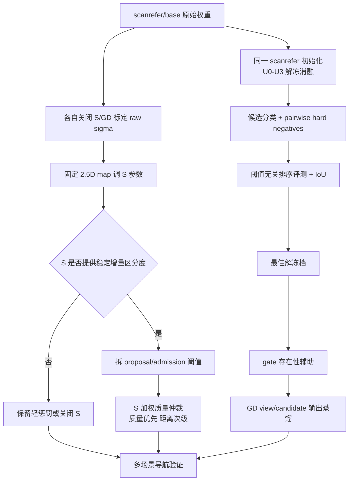

# VLVM Stage 4：S 语义仲裁与 TSP3D 置信度区分度优化

> 日期：2026-10-05  
> 范围：仅讨论 `tsp3d_scanrefer.pth` 与当前 `base` 权重；不采用已微调 gate 的推理结果。检测证据仅含 TSP3D 原始置信度 $c$、S 语义值及融合后的候选质量分。GD 可作为训练期教师，但不替代 TSP3D，也不作为本轮在线第二检测源。occ geometry 保持不变。

## 1. 总结判断

当前问题应拆成两条相互独立、按顺序推进的路线：

1. **机制层：先把现有权重用对。**先在关闭 S-penalty、GD、S 冲突门的条件下，分别为 scanrefer/base 标定各自的原始置信度工作点；再固定 $\sigma_{tar}$ 调 S 参数；最后才比较“当前乘法准入”与“S 主导仲裁”。
2. **模型层：直接训练候选置信度的排序能力。**以相同 scanrefer checkpoint 为初始化，做逐级解冻消融；主目标是正确候选压过在线硬假阳，而不是继续优先优化框或中间特征。gate 与 GD 蒸馏是辅助项，不能代替候选级区分损失。

对现有判断的校正如下：

- “3D 模型远弱于 2D 模型”只在**当前在线局部点云与类别短提示分布**下成立，不能推广为 3D 模型的普遍结论。TSP3D 在完整扫描式 3DVG 基准上本身具有较强定位能力；本项目的主要矛盾是训练分布与在线残缺点云不一致，以及语义置信度无法区分 TP/FP。[TSP3D 原论文](https://openaccess.thecvf.com/content/CVPR2025/html/Guo_Text-guided_Sparse_Voxel_Pruning_for_Efficient_3D_Visual_Grounding_CVPR_2025_paper.html)也明确面向 ScanRefer/ReferIt3D 式完整场景 3D grounding，而非连续导航中的局部视锥壳。
- E3 能证明 base 的**局部识别/定位能力提升**，但也证明其**置信度排序能力变差**；两者并不矛盾。
- 先不继续 S1/S2 解耦架构是合理的，但首轮结果只能说明当前实现与训练设置失败，不能证明几何/语义解耦这一类方法理论无效。
- 当前 active S 来源是 VLFM 风格的 **2.5D region ValueMap**。保留的 surface 版本仍把 3D 表面点落入 2D $(x,y)$ 桶，并非真正保留完整 3D 语义场。现阶段没有证据支持重建价值地图。

## 2. 现有证据与问题定责

### 2.1 E3：定位提升，区分度下降

| 指标 | base3090 | scanrefer | 判断 |
| :--- | ---: | ---: | :--- |
| hit@IoU 0.25 | 29.50% | 18.69% | base +10.81pp，识别/定位有效提升 |
| hit@IoU 0.50 | 11.58% | 5.21% | base +6.37pp |
| mean best IoU | 0.1636 | 0.1181 | base +0.0455 |
| 命中框分数均值 | 0.4743 | 0.6327 | base 整体左移 |
| 负样本分数均值 | 0.2232 | 0.3359 | base 的拒识也变强 |
| hit/miss 中位数间隔 | 0.168 | 0.310 | base 排序间隔约缩小一半 |
| potted plant hit@0.25 | 8.93% | 14.88% | 少样本类发生退化 |

因此，base 不是“识别无效”，而是**框更接近目标，同时正确框的分数优势不足且整体分数标尺漂移**。$\sigma_{tar}$ 只能重新选择工作点，不能恢复排序间隔。

E3 目前每个正视图只配一个负查询，负样本仍偏容易；它适合判断分数漂移和基础定位，不足以代表导航中会诱发停靠的高分硬 FP。

### 2.2 在线前置检测：假阳仍是主因

历史完整在线统计中：

| 证据 | 数值 | 含义 |
| :--- | :--- | :--- |
| TSP3D detection precision | 28.41%（3545/12477） | 写入前候选纯度低 |
| TSP3D TP/FP 原始分数均值 | 0.781 / 0.773 | gap 仅 +0.008，几乎不可分 |
| GD TP/FP 分数均值 | 0.646 / 0.556 | gap +0.089，2D 信号更有区分性但仍不充分 |
| S 的 TP/FP 均值 | 0.171 / 0.130 | 正确 gap 是 **+0.041**；旧文档中的 `+0.141` 是算术笔误 |
| 记忆候选 TP 率 | 44.8% | 机制过滤后仍不足一半 |
| `both` / `gd` / `tsp3d` 单源 TP 率 | 78.9% / 48.8% / 27.0% | 交叉证据有效，TSP3D 单源最弱 |
| 失败中的 FP | 884（72.2%） | 假阳停靠是首要失败模式 |
| 真目标覆盖前已因 FP 停错 | 743 集 | 假阳会提前终止探索 |

S 的均值差为正，说明它具备辅助价值；但 +0.041 的均值差不能证明它足以成为主排序器。必须补充 S-only AUROC/AUPRC、覆盖条件下的 TP/FP 分布及跨场景稳定性。

### 2.3 $\sigma_{tar}$ 搜索的当前结论

base、S-penalty 关闭、GD 关闭、occ 保持开启的四场景完整结果中：

| $\sigma_{tar}$ | 平均 SR | 平均 Oracle | 平均 SPL |
| ---: | ---: | ---: | ---: |
| 0.50 | 17.93% | 31.31% | 0.0767 |
| 0.55 | 24.75% | 40.15% | 0.1069 |
| 0.60 | 28.79% | 48.74% | 0.1255 |
| 0.65 | **31.31%** | **57.58%** | **0.1275** |
| 0.70 | 待四场景完成 | 待四场景完成 | 待四场景完成 |
| 0.75 | 待四场景完成 | 待四场景完成 | 待四场景完成 |

当前只能确定 0.65 是已完成区间的上边界最优点，不能在 0.70/0.75 完成前把 0.65 定稿。scanrefer 与 base 的分数分布不同，二者不得共用同一个 $\sigma_{tar}$ 结论。

## 3. S-penalty 路线修订

### 3.1 当前机制的真实行为

当前流程是：

$$
c \ge \sigma_{tar}
\rightarrow \text{occ gate}
\rightarrow c' = c\cdot w_S(S)
\rightarrow c' \ge \sigma_{tar}
\rightarrow \text{memory}
$$

其中：

- $S\ge t_S$ 时 $w_S=1$；
- $0<S<t_S$ 时 $w_S=\max(floor,S/t_S)$；
- 未覆盖 $S\le0$ 或 `None` 时 $w_S=uncovered\_w=1$，即免罚；
- 进入记忆后，导航目标在可锁候选中按**离机器人最近**选择，置信度与 S 不参与最终候选排序。

这意味着当前 S 只负责“拒绝谁”，不负责“多个已准入目标中选谁”。高分 FP 一旦通过，最近目标规则仍可能优先导航到它。

另一个实现边界是：TSP3D 服务端与 policy 都会在 S 查询前按原始 $\sigma_{tar}$ 过滤。当前 $w_S\le1$ 时没有逻辑错误；但若新机制允许高 S 提升低 $c$ 候选，则这些候选在计算 S 前已经消失。

### 3.2 第一阶段：只调参数，不改公式

控制变量固定为：GD 关闭、S 冲突门关闭、occ 开启且参数不变、2.5D region map 不变、memory-life 不变。

1. **分别标定 raw $\sigma_{tar}$。**base 等待 0.70/0.75 四场景完成；scanrefer 独立做同口径搜索。不能用同一阈值比较两套权重。
2. **固定各自最优 $\sigma_{tar}$ 后再调 S。**先调 $t_S$，再调 floor，最后调查询半径；避免四参数全排列掩盖因果。
3. **建议初始窄范围：**$t_S\in\{0.10,0.12,0.15,0.18\}$，$floor\in\{0.3,0.5,0.7\}$，$radius\in\{0.3,0.5,0.7\}\,m$。`uncovered_w` 首轮固定 1.0，防止把尚未建图误当成低语义证据。
4. **先离线 replay，再跑导航。**从已有 detection log 计算每组的准入 TP/FP、召回、precision 与 episode 级首次错误锁定；只把 Pareto 档送入四场景 SR/Oracle/SPL。

这一阶段回答的是“S 能否在不改框架的情况下过滤 FP”，不回答“S 能否主导候选选择”。

### 3.3 第二阶段：从 penalty 改为语义仲裁

用户提出的“以置信度为权重，按惩罚后 S 排序”方向成立，但若最终仍是 $q=c\times S$，它与当前乘法只有 $S$ 映射不同，并未真正改变两路证据的占比。

更清晰的机制应拆成四步：

1. **候选生成门：**用较低的 $\sigma_{prop}$ 保留可能被 S 验证的 TSP3D 候选；occ gate 继续一票否决空腔框。
2. **证据标准化：**分别把 $c$ 和 covered-S 映射到各自验证集上的可比较尺度。S 原值不是概率，不应直接解释为正确率。
3. **质量融合：**

   $$
   q=\sigma\left(\alpha\,\operatorname{logit}(\hat c)
   +\beta\,\operatorname{logit}(\hat S)+b\right),\quad \beta>\alpha
   $$

   其中 $\hat c$、$\hat S$ 是验证集标定后的分数。若只做无学习版本，可用 $q=\hat c^{\alpha}\hat S^{\beta}$；“增加 S 占比”由 $\beta>\alpha$ 明确定义，而不是靠交换公式中的名称。
4. **记忆仲裁：**$q\ge\tau_{admit}$ 才能进入记忆；多个候选并存时，先按 $q$ 选质量带，再在近似同分候选中用距离决定，不能继续完全按最近目标选择。

建议的候选选择不是纯 S Top-1，而是“**质量优先、距离次级**”。纯 S 排序会把用于探索的区域级语义先验误当成实例检测分数；纯距离又会放大最近 FP。可采用：先保留 $q\ge q_{max}-\delta$ 的质量带，再从带内选最近候选。

### 3.4 未覆盖不是低 S

必须保留三个状态：

| 状态 | 语义 | 建议行为 |
| :--- | :--- | :--- |
| covered-high | 有地图证据且 S 高 | 允许提升排序优先级 |
| covered-low | 有地图证据但 S 低 | 明确惩罚或拒绝 |
| uncovered | 该位置尚无可靠语义观测 | 不当作反证；保留 TSP3D 最低证据门槛，但不可无条件压过 covered-high |

如果把 uncovered 直接当 $S=0$，探索早期召回会显著受损；如果继续完全免罚且按最近选择，它又会成为 FP 绕过 S 的通道。因此 uncovered 应当是单独分支，而不是一个数值。

### 3.5 暂不修改语义价值地图

VLFM 的 ValueMap 本来用于为 frontier 提供语言相关探索价值，而非提供实例级检测概率；其成功依赖 RGB/VLM 语义与几何 frontier 的组合。[VLFM 原论文](https://arxiv.org/abs/2312.03275)支持把它作为探索先验，但不支持直接把单点最大值解释为目标存在概率。

当前不改 2.5D region map，原因有三点：

- 既往实验已显示 region 版本优于 surface 路径；
- 当前 S 查询采用半径内最大值，地图构建误差与融合误差尚未和仲裁公式误差分离；
- 项目中的探索/导航图已经定稿，直接重建语义地图会同时改变探索覆盖和检测准入，无法归因。

只有当固定候选集的离线统计表明 S-only 区分度跨场景不稳定，且错误主要来自地图峰值污染/错位时，才进入地图候补实验。候补也应先做轻量可靠性层，而不是恢复“全 3D”路线：为 S 同时记录覆盖次数、观测新鲜度、视角/距离质量；用多次观测的稳健聚合替代单次 max；按目标框投影区域查询而非只查一个近表面点。

## 4. 模型微调路线修订

### 4.1 解冻层数实验的正确基线

当前 base 并不是“只微调头部”：它冻结 stem、layer1/2 和 RoBERTa，同时训练 layer3/4、text projector、跨模态/TGP/CBA 相关模块及最终 head。它代表较广泛的顶层解冻端点。

解冻消融必须满足：

- 每一档都从同一个 `tsp3d_scanrefer.pth` 初始化；
- 当前 base 仅作为最宽解冻档的结果对照，不能以 base checkpoint 为起点再冻结，因为此前的参数漂移已经写入权重；
- 固定数据、batch、epoch、优化器、随机种子和 LR 规则；
- 冻结子树保持 `eval()`，防止 BN running statistics 与 Dropout 继续漂移；
- 以候选排序指标早停，不以总 loss 或单一 $\sigma$ 下的 accuracy 早停。

建议从窄到宽设置四档：

| 档位 | 可训练模块 | 目的 |
| :--- | :--- | :--- |
| U0 | 最终 `cls_conv` / 置信度 bias；bbox 回归冻结 | 只校正分数标尺与候选区分，最大限度保存 IoU 增益 |
| U1 | U0 + 最后一级文本-视觉融合与 text projector | 允许类别短提示适配，不动 3D backbone |
| U2 | U1 + backbone layer4 | 加入高层 3D 语义适配 |
| U3 | U2 + backbone layer3 | 对齐当前 base 的广泛解冻规模 |

“减少解冻层数”不是越少越好，而是在稳定性与适配能力之间找 Pareto 点。渐进解冻与分层学习率的核心目的正是降低灾难性遗忘；[ULMFiT 原论文](https://aclanthology.org/P18-1031/)给出了 gradual unfreezing 与 discriminative learning rates 的经典实践依据。

### 4.2 区分度必须直接监督候选置信度

每个候选需要一个“是否为正确目标框”的监督标签：正视图中与目标 GT 匹配且达到 IoU 标准的候选为正；其余候选、负视图候选和在线高分幻觉为负。训练目标分三层：

1. **候选分类损失：**BCE/Focal/ASL 负责概率方向。Focal Loss 的价值是降低大量易负样本的支配，让训练聚焦困难样本；这与当前在线高分 FP 问题一致。[Focal Loss 原论文](https://openaccess.thecvf.com/content_iccv_2017/html/Lin_Focal_Loss_for_ICCV_2017_paper.html)
2. **同视图排序损失：**对正确候选与最高分错误候选施加 pairwise margin：

   $$
   \mathcal L_{rank}=\operatorname{softplus}
   \left(m-z_{pos}+z_{hard\_neg}\right)
   $$

   它直接优化“正确目标必须压过最危险 FP”，比只压低所有负样本更贴近导航 Top-1 决策。pairwise ranking 与 AUC 优化本质相关，可用阈值无关指标判定。[PMLR pairwise/AUC 论述](https://proceedings.mlr.press/v30/Agarwal13.html)
3. **在线硬负样本：**从训练场景 rollout 中回收高分误框、同房间相似物、局部壳和贴墙结构，加入 replay pool。OHEM 的原始工作说明，检测训练的有效增益常来自少量高损失困难候选，而非继续增加大量易背景。[OHEM 原论文](https://openaccess.thecvf.com/content_cvpr_2016/html/Shrivastava_Training_Region-Based_Object_CVPR_2016_paper.html)

现有 20 个导航评测场景的失败日志只能用于诊断，不能直接回灌训练，否则会产生场景泄漏。硬负例应从训练场景按相同在线流程生成，并按 scene 划分 train/val。

### 4.3 gate 的定位：存在性拒绝，不是框间排序

现有 PresenceGate 输出的是整幅局部视图对目标查询的 $P_{exist}$。它能处理“该视图根本没有目标却强行出框”，但不能区分正视图内哪个候选框正确。因此：

- gate 可以作为前置拒绝器，目标是高召回下减少 target-absent FP；
- 候选置信度负责正视图内 TP/FP 排序；
- 两者需要分别评测、分别校准，不能用 gate 的提升替代候选 AUROC/AUPRC；
- 首轮不建议直接用 $P_{exist}\times c$ 作为唯一交付分数，因为乘法会再次改变分数尺度。先比较“gate 仅 veto”与“乘法融合”两个消融。

### 4.4 GD 蒸馏：对齐判断关系，不直接复制原始分数

“先蒸馏置信度分数与 gate 分数，暂缓中间特征和框回归蒸馏”的优先级合理，但需要补充三个限制：

1. **gate 蒸馏与候选蒸馏分开。**gate 教师标签是视图级存在性；候选教师标签是某个 3D 候选是否被 2D 证据支持。两种分数语义不同，不能共用一个软标签。
2. **不做原始数值回归。**GD 与 TSP3D 的分数标尺、先验和温度不同，直接令两者分数相等会把教师校准误差也蒸馏进去。应优先蒸馏正负排序、相对 margin 或经温度标定后的软目标。模型置信度校准与分类排序是不同问题；temperature scaling 可改善概率标尺，但不会创造新的排序能力。[Guo 等人的校准论文](https://proceedings.mlr.press/v70/guo17a.html)
3. **框损失可以暂缓，框关联不能省。**即使不蒸馏 2D 框坐标，也必须通过深度反投影/3D 一致性确定 GD 证据属于哪个 TSP3D 候选，否则候选级分数教师没有归属。

建议的蒸馏顺序：

| 阶段 | 教师信号 | 学生目标 | 是否建议首轮启用 |
| :--- | :--- | :--- | :---: |
| D0 | 无教师，GT + hard negative | candidate classification + pairwise rank | 是，模型主基线 |
| D1 | 经质检的 GD view existence | PresenceGate | 是，单独消融 |
| D2 | 经 2D-3D 关联的 GD 支持关系 | candidate pairwise/order | 是，D1 后 |
| D3 | GD calibrated soft probability | candidate/gate soft target | 候补 |
| D4 | decoder feature / box regression | 中间特征或框 | 暂缓 |

2D 教师只在训练期提供语义监督，最终在线主模型仍是 TSP3D，符合 3D-native 主线。ScanRefer 的原始设定本身是从点云和语言联合定位 3D 目标框，[ScanRefer 论文](https://www.ecva.net/papers/eccv_2020/papers_ECCV/papers/123650205.pdf)也说明几何定位与语言匹配是两个需要联合处理的部分；本轮只是把资源优先放在已经被实验证明薄弱的匹配分数上。

## 5. 统一评测指标

### 5.1 模型级

| 能力 | 必须报告的指标 | 说明 |
| :--- | :--- | :--- |
| 定位 | hit@IoU 0.25/0.50、mean best IoU | 验证 E3 的几何增益是否保留 |
| 候选排序 | AUROC、AUPRC、pairwise accuracy、TP/FP score gap | 判断区分度，不依赖单一阈值 |
| 高召回拒识 | FPR@TPR=90%/95%、precision@固定 recall | 对应“不能漏掉真目标”的导航约束 |
| 校准 | ECE、Brier、NLL | 决定阈值是否可迁移；不等同于排序能力 |
| 类别稳定性 | 六类分别统计，单列 potted plant | 防止总体均值掩盖少样本类退化 |

### 5.2 S 证据级

必须分别统计 raw $c$、S-only、融合 $q$：

- TP/FP 的覆盖率与 covered 条件分布；
- AUROC/AUPRC 及其相对 raw $c$ 的增量；
- covered-high / covered-low / uncovered 三路的 precision、recall；
- 按场景、类别、目标距离分层；
- 首次候选、最终入记忆候选与最终被选导航候选三层统计。

### 5.3 导航级

SR、Oracle、SPL 之外必须保留 fp/fn/nv、首次错误锁定时间、真目标覆盖前错误停止数。只看 SR 无法区分“模型没看见”“看见但没检出”和“被近处 FP 抢先”。

## 6. 实验顺序与判定门

### Phase A：现有权重的工作点

1. 完成 base $\sigma=0.70/0.75$ 四场景实验；
2. scanrefer 独立做 raw $\sigma$ 搜索；
3. 每套权重各自固定 $\sigma_{prop}/\sigma_{tar}$，不共享阈值；
4. 关闭冲突门与 GD，顺序调 $t_S\rightarrow floor\rightarrow radius$；
5. 用 detection replay 先筛档，再跑四场景。

判定门：若 S-only 在 covered 子集上不比 raw $c$ 提供稳定的 AUPRC 增量，则停止增加 S 权重，保留现有轻惩罚或关闭 S；不要通过改地图或更复杂公式强行制造收益。

### Phase B：S 主导仲裁

1. 拆分 $\sigma_{prop}$ 与 $\tau_{admit}$；
2. 固定 2.5D region map，比较当前 $c\cdot w_S$、显式加权融合 $q$、质量带内最近选择；
3. 保留 uncovered 独立分支；
4. 仅当 S 仲裁稳定降低 FP 且不显著抬高 fn，才替换当前 penalty。

判定门：机制收益必须来自“相同候选池下排序/准入更好”，而不是不同 $\sigma$ 带来的候选数量差异。

### Phase C：逐级解冻与区分度微调

1. 从同一 scanrefer checkpoint 训练 U0/U1/U2/U3；
2. 首轮统一使用 candidate classification + pairwise hard-negative ranking；bbox 回归冻结或极低权重；
3. E3 先选出同时保住 IoU、提高 AUPRC/FPR@TPR 的 Pareto 档；
4. 对入选档分别重新标定 $\sigma$，再进入四场景导航。

判定门：不能只以 score gap 绝对值或某个 $\sigma$ 下 SR 选权重。gap 会受标尺影响；AUROC/AUPRC 与高召回 FPR 才代表排序改善。

### Phase D：gate 与 GD 蒸馏

1. 在最佳 U 档上加 gate GT supervision；
2. 再加 view-level GD gate distillation；
3. 再加 candidate-level GD pairwise distillation；
4. 特征和框蒸馏只在输出层方法饱和后进入候补。

判定门：gate 必须报告 target-visible recall；任何降低大量 FP 但误关真目标的档位不得进入导航。candidate distillation 必须提升候选排序，而非只改变平均分数。

## 7. 最终路线图

本阶段不应优先修改语义地图，也不应恢复大规模 S1/S2 架构重构。最近的主线是：**先把候选阈值与 S 仲裁做成可归因的机制，再用小步解冻、候选排序损失和在线硬负例直接修复 TSP3D 的 TP/FP 区分度；gate 处理“有没有”，候选头处理“哪个对”，GD 只提供训练期辅助语义。**
