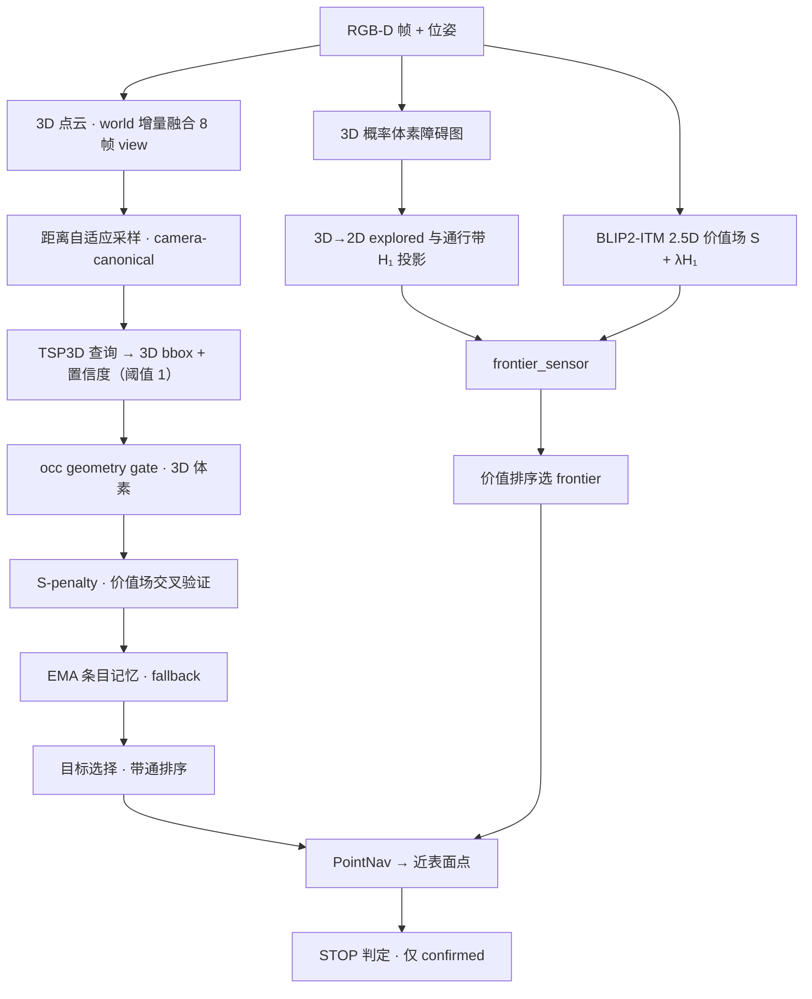

# VLVM：3D Native 零样本目标导航系统与微调策略

> 定位：本文件记录已定稿的系统机制与被采用的 TSP3D 微调策略，作为后续实验的基线说明。

> 口径：实验不在本地执行，仓库保留完整导航框架与微调代码；本文数值全部引自 `Results/` 下的阶段日志文档。

> 状态（2026-10-26）：TSP3D 微调完结，权重锁定 `vlvm_v1.pth`；导航机制按 S5 定稿；仅 GD proposer 未定稿。

## 0. 摘要

| 模块 | 状态 | 定稿口径 |
| :--- | :--- | :--- |
| TSP3D 微调 | **定稿** | base → U0/U1/U2/U3 → R1；采用 R1 E3 |
| 几何障碍场 | **定稿** | `ProbabilisticGrid` 3D log-odds 体素（±2、截断 ±6、体素 0.05 m） |
| 语义价值场 | **定稿** | `ITMPolicyV1` region 式 2.5D 场，`S + λ·H₁`，λ = 0.3 |
| 时空融合与输入适配 | **定稿** | world 增量地图 8 帧窗 + 视角去重 + 近场刷新 + 距离自适应采样 |
| 感知与目标定位 | **定稿** | TSP3D 单阶段 3D bbox 回归 + S-penalty 双阈值准入 |
| 几何准入 | **定稿** | occ 一致性门（8 体素 / 0.001 / 0.90 自由比）+ `geom_unknown` 保留 |
| 语义准入 | **定稿** | S-penalty v1，$$\sigma_c = c·w_S$$ ，`t_S` = 0.14，`s_min` = 0.07 |
| 记忆与生命周期 | **定稿** | EMA 合并 + fallback |
| 目标选择 | **定稿** | stable 硬过滤 → $$\sigma_c$$ 带通档 → confirmed 优先 → dist → num_obs / freshness tiebreak |
| 停止 | **定稿** | 仅 confirmed 可停；provisional 近场 1.2 m 内 3 帧未升级则拉黑 |
| GD proposer | **未定稿** |  |

## 1. 系统架构总览

### 分层对应（模块 → 实现文件）

| 层 | 模块 | 实现文件 |
| :--- | :--- | :--- |
| 微调 | 数据 / 损失 / pipeline | `ft_tsp3d/`、`ft_tsp3d/data_processing/` |
| 决策主体 | `TSP3DObjectNavPolicy` | `vlfm/policy/tsp3d_objectnav_policy.py` |
| 探索 / 价值场 | `BaseITMPolicy`、`ITMPolicyV1` | `vlfm/policy/itm_policy.py`、`vlfm/mapping/value_map.py` |
| 几何场 | `ProbabilisticGrid`、`ObstacleMap3D` | `vlfm/mapping/obstacle_map.py` |
| 输入适配 | pipeline / world_map / sampling | `vlfm/tsp3d_models/fussion_utils/` |
| 检测 | `TSP3D` 服务端 / 客户端 | `vlfm/vlm/tsp3d.py`、`vlfm/tsp3d_models/bdetr.py` |
| 几何准入 | `BoxOccupancyGate` | `fussion_utils/target_geometric_gating.py` |
| 语义准入 | `SPenaltyConfig` | `fussion_utils/s_penalty.py` |
| 记忆 | `TargetMemoryManager` | `fussion_utils/target_memory_manager.py` |
| `GD proposer` |  |  |

## 2. 已定稿机制

### 2.1 感知与目标接地

| 项 | 取值 |
| :--- | :--- |
| 主干 | TSP3D（文本引导稀疏体素剪枝，单阶段 3D bbox 回归） |
| 模型体素 | 0.01 m，`d_model` = 128，单类 |
| 剪枝阈值 | `sigma_sce` = 0.15，近场自适应至 [0.12, 0.15] |
| 补点阈值 | `tau` = 0.15 |
| 返回候选 | `nms_pre` = 1，每帧至多 1 个候选 |
| 候选池下限 | `raw c ≥ sigma_prop` 独立于准入；`sigma_prop` = 0.45 |
| 准入 (S-penalty) | $$\sigma_c$$ ≥ sigma_tar，$$\sigma_c$$ = 0.60 |

### 2.2 几何场

| 项 | 取值 |
| :--- | :--- |
| 表示 | `ProbabilisticGrid` int8 log-odds，400×400×28 |
| 体素 / 分辨率 | 0.05 m，20 px/m，覆盖 20 m × 20 m |
| 观测更新 | 端点 +2，射线 −2，截断 [−6, +6] |
| 占据判据 | 后验 > 0，高度带 [0.15, 1.50] m |
| 膨胀 | 圆柱结构元 `agent_radius` = 0.18 m，高度 0.88 m |
| 导航切片 | `nav_slice_height` = 0.30 m |
| 小连通域过滤 | `obstacle_map_area_threshold` = 1.5 m² |

### 2.3 语义价值场

| 项 | 取值 |
| :--- | :--- |
| 样式 | `vm_style = region` (`ITMPolicyV1`) |
| 通道 | BLIP2-ITM cosine，单通道 |
| 锥形置信度 | `cos²θ` 重映射至 [0.25, 1.0] |
| 查询 | 半径 0.5 m 圆盘内非零像素中位数，多通道取最大 |
| 通行带层 | `h_z_min` = 0.15，`h_z_max` = 0.88（15 层） |
| 打分 | `S + λ·H₁`，λ = 0.3，`h_norm_max` = 1.0 |
| 双用途 | frontier 排序 + S-penalty 交叉验证查询 (`_query_semantic_at`) |

### 2.4 时间融合与输入适配

| 项 | 取值 |
| :--- | :--- |
| 路线 | `fusion_style = world`；`none` 为对照 |
| 帧窗 | `wm_max_frames` = 8 |
| 视角去重 | 位移 < 0.15 m 且偏航 < 15° 丢弃该帧 |
| 体素 / 半径 | 0.02 m，6.0 m |
| 近场刷新 | `wm_near_refresh_radius` = 3.0 m，值刷新开启 |
| 体素上限 | 400k，超出按距离保留近者 |
| 距离自适应采样 | ≤1.5 m 用 0.01 m；1.5–3.0 m 用 0.02 m；>3.0 m 用 0.05 m |
| 点数上限 | 200k（`cap_style = random`） |
| 坐标 | xy 平移 + 偏航旋转，z 不平移 |
| 传输 | float16 + base64，字段 (x,y,z,r,g,b) |

### 2.5 几何与语义准入

**occ 一致性门**（几何检测级，先于 S-penalty）

| 规则 | 判据 | 结果 |
| :--- | :--- | :--- |
| 越界 (out_of_bounds) | 框 AABB 与占据栅格无交集 | 放行，状态 `geom_unknown` |
| insufficient_occ_voxels | `占据体素 < 8` | 拒绝 |
| low_occupancy_ratio | `占据体素 / 体积 < 0.001` | 拒绝 |
| air_penetration | `探索体素 > 16` 且 `自由比 > 0.90 ` 且 `占据体素 < 16` | 拒绝 |
| arguments | `occ_min_voxels` / `occ_min_ratio` / `free_ratio_rejection_thresh` | 8 / 0.001 / 0.90 |

**S-penalty v1**（语义级，后于 occ 门）

| 项 | 取值 |
| :--- | :--- |
| 查询点 | bbox 距相机最近 4 角的均值（near-surface point） |
| 查询半径 | 0.5 m |
| $$W_s$$ | `S ≤ 0` → 1.0；`S > 0` → `min(1, max(S, 0.07) / t_S)` |
| 阈值 | `t_S` = 0.14 |
| Floor | `s_min` = 0.07 |
| S Uncovered | `uncovered_w` = 1.0（免罚） |
| 准入 | $$\sigma_c$$ = c·w_S ≥ 0.60 |
| conflict 子机制 | `c ≥ 0.80` 且 `0 < S < t_S` 直接拒绝，**已放弃并关闭** |

### 2.6 记忆与生命周期（EMA + fallback）

条目字段为类别、质心、近表面点、num_obs、$$\sigma_c$$ 五列、生命周期状态与来源标签。

目标进入记忆后按 merge、revive、new、trans & delete 四步处理。

**第一步 merge**（同类别最近质心 3D 距离 < 0.5 m，且命中条目状态非 stable）

| 字段 | 行为 |
| :--- | :--- |
| 新信息门 | 与上次观测位姿比较，位移 ≥ 0.2 m、或朝向差 ≥ 10°、或间隔 ≥ 3 步，才计一次新观测 |
| num_obs | 通过新信息门则 +1，同一位姿的连续帧不累加 |
| 质心 | 0.8 × 旧值 + 0.2 × 新检测，无论是否带新信息都逐帧刷新 |
| 分数 | 仅带新信息时更新 max / latest / ema_03 / ema_05 / ema_08 五列 |
| near_miss | 连续计数清零 |
| total_miss | 不清零，累计口径只服务于 stable 删除 |
| 近表面点 | 保留首次写入 |
| 状态 | 不改写，merge 内升级关闭 |

命中 stable 条目不吸收证据，转入第二步复活判定。

**第二步 revive**（stable 回到可追状态的唯一入口）

| 项 | 取值 |
| :--- | :--- |
| 触发 | 新检测质心落在 stable 条目 0.5 m 内 |
| 时间窗 | 距该条目上次匹配 ≤ 10 步 |
| 置信地板 | $$\sigma_c$$ ≥ 0.50 |
| 结果 | stable → provisional；near_miss 清零；revive_count +1；num_obs +1；分数历史保留 |
| 累计计数 | total_miss 不复位，反复复活仍受累计上限约束 |
| 失败 | 该条目不吸收本次证据，检测按新条目处理 |

**第三步 new**

| 状态 | 条件 |
| :--- | :--- |
| confirmed | $$\sigma_c$$ ≥ 0.60 且 几何状态非 `geom_unknown` |
| provisional | 0.50 ≤ $$\sigma_c$$ < 0.60 且 1.0 ≤ dist ≤ 4.0 m；`geom_unknown` 条目同条件 |

geom_unknown 条目最高只到 provisional，即使 $$\sigma_c$$ ≥ 0.60 也不进入 confirmed。provisional 档需要准入线同步降到 0.50，否则该档为空。

**第四步 trans & delete**

| 当前状态 | 触发 | 动作 |
| :--- | :--- | :--- |
| confirmed | 近场锥内连续 near_miss ≥ 3 | → stable，连续计数清零 |
| provisional | 近场锥内连续 near_miss ≥ 3 | → stable，连续计数清零 |
| confirmed / provisional | 距上次匹配 ≥ 60 步 | → stable，stale_demote |
| stable | 连续 near_miss ≥ 5 | 删除，stable_miss_delete |
| stable | 累计 near_miss ≥ 8 | 删除，stable_total_miss |
| stable | 距上次匹配 ≥ 60 步 | 删除，stable_stale_purge |
| provisional | 每帧检查升级门槛 | → confirmed，见下表 |
| confirmed / provisional | - | 永不直接删除 |

**update**（provisional → confirmed，每帧检查，不依赖 merge）

| 条件 | 值 |
| :--- | :--- |
| num_obs | ≥ 2 |
| 质心距离 | ≤ 4.0 m |
| 分数口径 | `sigma_c_latest` ≥ 0.52 |

near_miss 仅当条目落入 2.5 m 近场 FOV 锥且当帧无匹配检测时 +1。merge 与 revive 清零连续计数，累计计数只用于删除判定，因此一条被反复复活的轨道仍会在累计超限时被删除。

stable 是唯一的删除池，所有删除都发生在 stable。当前导航目标半径 0.5 m 内的条目豁免累加，按条目质心判定；provisional 与由 provisional 升级而来的条目不在豁免范围。

### 2.7 目标选择与停止

**候选过滤**：条目必须非 `stable`、不在停止黑名单、且通过可锁定检查。

**排序键**（逐级比较，前一级相同才比较下一级）

| 级 | 键 | 方向 |
| :--- | :--- | :--- |
| 1 | $$\sigma_c$$ 带通档 | `0.65–0.70` → `0.60–0.65` → `0.55–0.60` → `≥0.70` → `<0.55` |
| 2 | 生命周期状态 | `confirmed` 先于 `provisional` |
| 3 | 质心 2D 距离 | 按 0.5 m 分桶，近者优先 |
| 4 | num_obs | 桶内 `≥2` 优先，再取较大者 |
| 5 | freshness | 距上次观测步数更小者优先 |

**导航点与锁保持**：目标点取条目的近表面点；目标位移 < 0.1 m 时保持，位移 < 0.5 m 且距新目标 > 2.0 m 时也保持，否则切换。

**停止**

| 项 | 取值 |
| :--- | :--- |
| 可停资格 | 仅 `confirmed`；`provisional` 可追不可停 |
| 停靠半径 | `pointnav_stop_radius` = 0.90 m |
| 近场放弃 | `provisional` 追到 1.2 m 内，每帧左转确认，超过 3 帧仍未升级则把该轨道加入停止黑名单并回 explore |
<!-- | 已删除 | `num_obs ≥ 3` 停止门槛、当前帧重确认、视角扩张复核、`stop_blocked` 标记 | -->

## 3. 微调策略

### 3.1 数据

| 项 | 取值 |
| :--- | :--- |
| 场景池 | HM3D annotated train 137 场景 |
| 划分 | seed 0，场景级 123 训练 / 14 验证，导航评测场景排除 |
| 局部视图 | K ∈ [1, 8] 帧，均值 4.812；640×480，hfov 79°，相机高 0.88 m |
| 深度 | 0.5–5.0 m，反投影 fx = fy = 390.4 |
| 融合 | 与在线同源：world 8 帧、0.02 m、6.0 m、3.0 m 近场刷新 |
| 正样本 | 目标可见像素 ≥ 40 且视图内目标点 ≥ 40；同类取可见面积最大 |
| 负样本 | 同类全部低于可见阈值；正负比 1 : 3 |
| 截断权重 | ≤0.70 权重 1.0；0.70–0.85 权重 0.5；>0.85 丢弃 |
| 训练集 | 23,031 views / 89,620 records / 9.05×10⁸ 点 |
| 验证集 | 2,638 views / 10,360 records（正 2,590 / 负 7,770） |

### 3.2 损失

| 项 | 定义 |
| :--- | :--- |
| base | `L_base = L_cls + L_l1 + L_giou3d + L_bg` |
| rank | `L_rank = softplus(m − z_pos + z_hardneg)` |
| margin | m = 0.2，权重 1.0 |
| 正候选判据 | 与 GT 的 3D IoU ≥ 0.25 |
| rank 构造 | 在线同名 view 内构造 pair，不新增数据文件 |

### 3.3 解冻档位

| 档位 | 可训练模块 | 冻结 | 可训练参数 |
| :--- | :--- | :--- | ---: |
| base | U3 + `head.bbox_conv`，即全部 head + layer3/4 | stem、layer1/2、RoBERTa | 12,797,194 |
| U0 | `head.cls_conv` | 其余全部 | 129 |
| U1 | `cls_conv`、`text_projector`、TGP（`keep_trans/keep_conv`）、CBA（`com_trans/com_cls/pos_embed`）、`fuse`、FPN（`up/lateral/out_block_*`） | `bbox_conv`、全部 backbone、RoBERTa | 4,795,908 |
| U2 | U1 + `vision_backbone.layer4` | `bbox_conv`、stem、layer1–3、RoBERTa | 7,468,292 |
| U3 | U2 + `vision_backbone.layer3` | `bbox_conv`、stem、layer1/2、RoBERTa | 12,796,420 |

固定项：4 档均从 `tsp3d_scanrefer.pth` 独立初始化；AdamW（β 0.9/0.999，ε 1e-8），wd 1e-4，clip 0.1；分层 LR 1e-4（head）/ 5e-5（跨模态）/ 1e-5（backbone）；3 epoch × 23,031 step，seed 0；第 1 epoch 线性 warmup，其余 cosine 至 1e-6。

### 3.4 采用结论

| 项 | 定稿取值 |
| :--- | :--- |
| 权重 | `data/vlvm_v1/vlvm_v1.pth`（R1 E3），SHA256 `a9d7c085f3cb8576494f1b8ca45be6b61b9bd92232d3d9b1c90b58d49e0a1c3b` |
| 边界 / 损失 | U1 + `L_base + L_rank` |
| 工作点 | `sigma_tar` = 0.60（无 S-penalty 四场景 grid 最优） |
| 主导指标 | hit@0.25 29.11% → 33.63%（+4.52 pp）；AUPRC 0.4107 → 0.4511；FPR@TPR95 0.7854 → 0.5901 |

## 4. 未定稿机制

### 4.1 GD proposer

| 项 | 现状 |
| :--- | :--- |
| 代码状态 | 已实现并可运行（`gdp_enable` 在 YAML 中为 True） |
| 定稿配置 | 关闭；S4/S5 全部正式对照 run 均为 `gdp_enable=False` |
| 触发 | 每 5 帧（`gdp_every_n` = 5），`box_thr` 0.4，至多 1 框 |
| 2D→3D | 框掩码腐蚀 5 px、回投影、DBSCAN（eps 0.2 m / min_pts 100）取最大簇 |
| 投票 | 同物判据（质心 0.5 m 或 IaU 0.3 或包含度 0.8）→ `both`；否 → `gd` |
| 消费 | `both` 复用 TSP3D 的 $$\sigma_c$$ 并清可疑标记；`gd` 单票写入、$$\sigma_c$$ = `sigma_tar`、需 num_obs ≥ 2 才可锁定 |
| 未定项 | 触发方式、确认语义、是否保留 |
| 依据 | S5 §4.3 与 S6 §2：S5 基线 `gdp_enable=False`，GD 的触发、确认语义与去留转入 S6 单独调整 |
