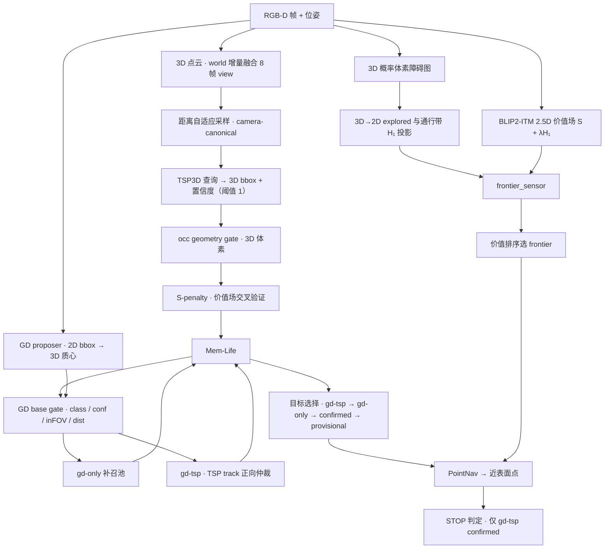

# VLVM：3D Native 零样本目标导航系统与微调策略

> 状态（2026-11-08）：TSP3D 微调完结，权重锁定 `vlvm_v1.pth`；§2.1–§2.7 按 **S6 final** 定稿；§2.8 的 navigate 侧选择与停止按 S6 final，explore 侧含双模 frontier 切换、stuck 回退与复核（recheck），对应当前导航架构；shadow 类诊断不改变动作，本文不记录。

## 0. 摘要

| 模块 | 状态 | 口径 |
| :--- | :--- | :--- |
| TSP3D 微调 | **定稿** | base → U0/U1/U2/U3 → Rank；采用 vlvm v1 |
| 几何障碍场 | **定稿** | `ProbabilisticGrid` 3D log-odds 体素（±2、截断 ±6、体素 0.05 m） |
| 语义价值场 | **定稿** | `ITMPolicyV1` region 式 2.5D 场，`S + λ·H₁`，λ = 0.3 |
**TSP3D Adaption**
| 时空融合与输入适配 | **定稿** | world 增量地图 8 帧窗 + 视角去重 + 近场刷新 + 距离自适应采样 |
| 感知与目标定位 | **定稿** | TSP3D 单阶段 3D bbox 回归 |
**GD Proposer**
| GD proposer | **定稿** | gd-only 全类别近场补召 + gd-tsp track-only 正向仲裁；gd-only: base gate + gd-only depth_ok, gd-tsp track merge confirmed/provisional 可绕过 depth；stable 直接放弃 |
| GD 参数 | **定稿** | `gd_calib` 超参块（唯一来源，无 env）：`every_n` 1、`max_boxes` 4、`box_thr` 0.40、caption vocab、merge 0.5/0.3/0.8 |
**Memory Life Manager**
| 几何准入 | **定稿** | occ geometry gate（64 体素 / 0.01 / 0.90 自由比）+ `geom_unknown` 保留 |
| 语义准入 | **定稿** | `S ≤ 0` → 1.0；`S > 0` → `min(1, max(S, s_min) / t_S)`；$$\sigma_c = c·w_S$$ ，`t_S` = 0.14，`s_min` = 0.07 |
| 记忆与生命周期 | **定稿** | origin：tsp-confirmed / tsp-provisional / gd-tsp / gd-only，lifecycle：confirmed / provisional / stable / gd，行为：Merge (EMA + new_info + merge_gd/tsp) / New / upgrade / trans / delete /revive |
**Goal Select and Stop**
| 目标选择 | **定稿** | `gd-tsp > gd-only > confirmed > provisional` |
| 停止 | **定稿** | 仅 `gd-tsp`可停；TSP-confirmed/provisional、gd-only 不可停；`pointnav_stop_radius=0.90 m` |
| Explore Recheck | **定稿** | frontier 耗尽 → 记忆航点巡回，队列耗尽就地 STOP |
| Explore Mode | **定稿** | `S ≥ 0.15` 走语义 frontier，否则最近 frontier（sticky 0.5 m） |

## 1. 系统架构总览

### 分层对应（模块 → 实现文件）

| 层 | 模块 | 实现文件 |
| :--- | :--- | :--- |
| 微调 | 数据 / 损失 / pipeline | `ft_tsp3d/`、`ft_tsp3d/data_processing/` |
| 决策主体 | `TSP3DObjectNavPolicy` | `vlfm/policy/tsp3d_objectnav_policy.py` |
| 探索 / 价值场 | `BaseITMPolicy`、`ITMPolicyV1` | `vlfm/policy/itm_policy.py`、`vlfm/mapping/value_map.py` |
| 几何场 | `ProbabilisticGrid`、`ObstacleMap3D` | `vlfm/mapping/obstacle_map.py` |
| 输入适配 | pipeline / world_map / sampling | `vlfm/tsp3d_models/fussion_utils/` |
| 检测 | `TSP3D` 服务端 / 客户端 | `vlfm/vlm/tsp3d.py`、`vlfm/tsp3d_models/bdetr.py` |
| 几何准入 | `BoxOccupancyGate` | `vlfm/vlvm/memory_life/target_geometric_gating.py` |
| 语义准入 | `SPenaltyConfig` | `vlfm/vlvm/memory_life/s_penalty.py` |
| 记忆 | `TargetMemoryManager` | `vlfm/vlvm/memory_life/target_memory_manager.py` |
| GD proposer | 初筛 / 路由 / 仲裁 | `vlfm/vlvm/grounding_dino/mechanism.py` |
| GD 离线标定 | proposal 精度 / 阈值标定 | `vlfm/vlvm/grounding_dino/calibration.py`、`vlfm/vlvm/grounding_dino/gd_offline_cal.py` |
| 目标选择 | tier 排序 / 导航点选择 | `vlfm/policy/tsp3d_objectnav_policy.py` |
| Explore Recheck | 航点队列 / 推迟 STOP | `vlfm/vlvm/recheck/expl_recheck.py` |
| Explore Mode | 双模切换 / stuck 回退 | `vlfm/vlvm/recheck/explore_mode.py`、`vlfm/vlvm/recheck/explore_runtime.py` |

## 2. 系统机制

### 2.1 感知与目标接地

| 项 | 取值 |
| :--- | :--- |
| 主干 | TSP3D（文本引导稀疏体素剪枝，单阶段 3D bbox 回归） |
| 模型体素 | 0.01 m，`d_model` = 128，单类 |
| 剪枝阈值 | `sigma_sce` = 0.15，近场自适应至 [0.12, 0.15] |
| 补点阈值 | `tau` = 0.15 |
| 返回候选 | `nms_pre` = 1，每帧至多 1 个候选 |
| 候选池下限 | `raw c ≥ sigma_prop` 独立于准入；`sigma_prop` = 0.45 |
| 准入 (S-penalty) | $$\sigma_c$$ ≥ sigma_tar，$$\sigma_c$$ = 0.60 |

### 2.2 几何场

| 项 | 取值 |
| :--- | :--- |
| 表示 | `ProbabilisticGrid` int8 log-odds，400×400×28 |
| 体素 / 分辨率 | 0.05 m，20 px/m，覆盖 20 m × 20 m |
| 观测更新 | 端点 +2，射线 −2，截断 [−6, +6] |
| 占据判据 | 后验 > 0，高度带 [0.15, 1.50] m |
| 膨胀 | 圆柱结构元 `agent_radius` = 0.18 m，高度 0.88 m |
| 导航切片 | `nav_slice_height` = 0.30 m |
| 小连通域过滤 | `obstacle_map_area_threshold` = 1.5 m² |

### 2.3 语义价值场

| 项 | 取值 |
| :--- | :--- |
| 样式 | `vm_style = region` (`ITMPolicyV1`) |
| 通道 | BLIP2-ITM cosine，单通道 |
| 锥形置信度 | `cos²θ` 重映射至 [0.25, 1.0] |
| 查询 | 半径 0.5 m 圆盘内非零像素中位数，多通道取最大 |
| 通行带层 | `h_z_min` = 0.15，`h_z_max` = 0.88（15 层） |
| 打分 | `S + λ·H₁`，λ = 0.3，`h_norm_max` = 1.0 |
| 双用途 | frontier 排序 + S-penalty 交叉验证查询 (`_query_semantic_at`) |

### 2.4 时间融合与输入适配

| 项 | 取值 |
| :--- | :--- |
| 路线 | `fusion_style = world`；`none` 为对照 |
| 帧窗 | `wm_max_frames` = 8 |
| 视角去重 | 位移 < 0.15 m 且偏航 < 15° 丢弃该帧 |
| 体素 / 半径 | 0.02 m，6.0 m |
| 近场刷新 | `wm_near_refresh_radius` = 3.0 m，值刷新开启 |
| 体素上限 | 400k，超出按距离保留近者 |
| 距离自适应采样 | ≤1.5 m 用 0.01 m；1.5–3.0 m 用 0.02 m；>3.0 m 用 0.05 m |
| 点数上限 | 200k（`cap_style = random`） |
| 坐标 | xy 平移 + 偏航旋转，z 不平移 |
| 传输 | float16 + base64，字段 (x,y,z,r,g,b) |

### 2.5 几何与语义准入

**occ 一致性门**（几何检测级，先于 S-penalty）

| 规则 | 判据 | 结果 |
| :--- | :--- | :--- |
| 越界 (out_of_bounds) | 框 AABB 与占据栅格无交集 | 放行，状态 `geom_unknown` |
| insufficient_occ_voxels | `占据体素 < 64` | 拒绝 |
| low_occupancy_ratio | `占据体素 / 体积 < 0.01` | 拒绝 |
| air_penetration | `探索体素 > 16` 且 `自由比 > 0.90 ` 且 `占据体素 < 16` | 拒绝 |
| arguments | `occ_min_voxels` / `occ_min_ratio` / `free_ratio_rejection_thresh` | 64 / 0.01 / 0.90 |

**S-penalty**（语义级，后于 occ 门）

| 项 | 取值 |
| :--- | :--- |
| 查询点 | bbox 距相机最近 4 角的均值（near-surface point） |
| 查询半径 | 0.5 m |
| $$W_s$$ | `S ≤ 0` → 1.0；`S > 0` → `min(1, max(S, s_min) / t_S)` |
| 阈值 / Floor | `t_S` = 0.14 / `s_min` = 0.07 |
| S Uncovered | `uncovered_w` = 1.0（免罚） |
| 准入 | $$\sigma_c$$ = c·w_S ≥ 0.60 |

### 2.6 GD proposer

> 结论：GD 不是独立覆盖源，而是**近场补召 + TSP3D 正向仲裁**。

**gd_calib 超参（唯一来源，无 `GD_CALIB_*` env）**

| 键 | 值 | 含义 |
| :--- | :---: | :--- |
| `every_n` | 1 | 查询节流（步） |
| `record_every_n` | 1 | 记录节流（仅日志） |
| `box_thr` | 0.40 | GD logit 阈值 |
| `max_boxes` | 4 | 单帧提案上限 |
| `port` | 12181 | GD 服务端口 |
| `caption_style` | `vocab` | 类别表描述 |
| `min_dist` | 1.0 m | 近距拒绝 |
| `erode_iters` / `min_pixels` | 5 / 256 | 2D 框腐蚀与最小面积 |
| `rand_subarray` | 5000 | 深度点采样数 |
| `dbscan_eps` / `dbscan_min_points` | 0.2 / 100 | 3D 聚类 |
| `merge_dist` / `merge_iau` / `merge_containment` | 0.5 / 0.3 / 0.8 | 同物判定（GD ↔ track / candidate） |
| `new_info_dist` / `new_info_yaw_deg` / `new_info_steps` | 0.2 / 10.0 / 3 | GD 新信息门 |
| `max_fails` | 2 | 连续 `no_gd` 熔断 |
| `save_points` / `max_points_saved` / `save_images` / `image_dir` | false / 64 / false / null | 离线调试落盘 |

**两条路径**

| 路径 | 输入 | 关联条件 | 写记忆 | 状态 | 可停 |
| :--- | :--- | :--- | :--- | :--- | :---: |
| `gd-only` | 未关联 TSP3D 的 GD bbox | 全类别 + 近场 + `occ_passed` | `accumulate_gd_only(...)` | `lifecycle="gd"`、`origin="gd-only"` | 否 |
| `gd-tsp` | GD bbox 命中 TSP3D `provisional/confirmed` track | `track_same` + track 状态 ∈ confirmed / provisional（不经 occ 门） | `accumulate(force_confirmed=True, gd_evidence_only=True, origin="gd-tsp", block_stable=True, expected_memory_id=track)` + `apply_gd_evidence` | `confirmed`、`origin="gd-tsp"` | 是 |

**base gate**（逐帧、按顺序；任一失败即拒绝）

1. `canon` 属于当前 episode 目标类别（多类别 `|` 分割）。
2. `conf >= gd_conf_min`，默认 0.40。
3. `in_fov == True`。
4. `dist_robot <= gd_max_dist`，默认 5.0 m。
5. `track_same & stable` 先拦截：在 `depth_ok` 任一取值下都 `blocked`，不升级、不写记忆。
6. 关联 track 后判 depth：`depth_ok=False` 时仅 `track_same & lifecycle_state in (confirmed, provisional)` 允许使用 track centroid 继续 gd-tsp merge，写 `depth_relaxed=true`；gd-only new/merge、candidate-only 一律 `reason=depth_not_ok` 拒绝，不写记忆。
7. 未通过 base gate 的 proposal 只写 `mechanism.decisions` 的 `base_rejected`，不写记忆。

**gd-only**

- 类别白名单全放开：`gd_only_classes=""`。
- 几何门使用 `occ_passed=True`；`occ_confirmed` 仅作诊断/排序特征；`geom_unknown` 可进入。
- **无额外 conf gate**；只受 base gate `gd_conf_min=0.40` 约束。
- 重复 GD 命中只累计 `gd_hits/gd_conf`，不升级 confirmed；不伪造 `sigma_c`；`stop_eligible=false`。
- 后续 TSP3D 候选合并命中时，由 `TargetMemoryManager.accumulate` 提升为 `confirmed`（`reason=gd_only_tsp_merge`，`promoted_from_gd_only=true`，`origin=gd-tsp`）。

**gd-tsp**

- track-only + merge-only：仅 `track_same & lifecycle_state in (confirmed, provisional)`；candidate-only 只记 `association=candidate_only`，不写 gd-tsp；无法合并到目标 track 时记 `blocked`，不新建 track。
- 无额外前置门：路由在 gd-only 的 occ 门之前完成，不要求候选 `occ_passed`，也不要求 `gd_pos`/候选匹配；写记忆用 track 质心，缺 `expected_memory_id` 则 `blocked`。
- `force_confirmed=True`：provisional 直接提升为 confirmed；已是 confirmed 只补 GD 证据。
- `block_stable=True`：命中 stable 不写 GD 证据、不复活、不改预算。
- `apply_gd_evidence` 只写 `gd_hits/gd_conf_max/gd_conf_last/gd_last_step/gd_candidate_pos/gd_last_candidate_id`；不改质心、`num_obs`、`sigma_c` 或 TSP3D 分数。

**参数**

| 参数 | 值 |
| :--- | :---: |
| `enable_gd_mechanism` | `true` |
| `gd_conf_min` | `0.40` |
| `gd_max_dist` | `5.0 m` |
| `gd_only_classes` | `""`（全部目标类别） |
| `upgrade_min_obs` | `4` |
| gd-only depth | 固定必须 `depth_ok=True` |

### 2.7 记忆与生命周期

条目字段为类别、质心、近表面点、num_obs、$$\sigma_c$$、生命周期状态与来源标签；GD 条目额外记录。

`lifecycle`: confirmed / provisional / stable / gd；`origin`：tsp-confirmed / tsp-provisional / gd-tsp / gd-only

目标进入记忆后按 Merge、revive、New、trans & delete 四步处理；`gd-only` 条目单独进入 GD 池，不参与这套 TSP3D 升级/删除预算。

**Merge**（同类别最近质心 3D 距离 < 0.5 m，且命中条目状态非 stable）

| 字段 | 行为 |
| :--- | :--- |
| 新信息门 (new_info) | 与上次观测位姿比较，位移 ≥ 0.2 m、或朝向差 ≥ 10°、或间隔 ≥ 3 步，才计一次新观测 |
| num_obs | 通过新信息门则 +1，同一位姿的连续帧不累加 |
| EMA | 质心：0.8 × 旧值 + 0.2 × 新检测，无论是否带新信息都逐帧刷新 |
| near_miss | 连续计数清零 |
| total_miss | 不清零，累计口径只服务于 stable 删除 |
| 近表面点 / 状态 | 保留首次写入 / 仅 `num_obs ≥ upgrade_min_obs` 的 provisional→confirmed 例外（`reason=base_upgrade`、`trigger=merge`），其余不改写 |

命中 stable 条目不吸收证据，转入第二步复活判定。

**new**

| 状态 | 条件 |
| :--- | :--- |
| confirmed | $$\sigma_c$$ ≥ 0.60 且 几何状态非 `geom_unknown` |
| provisional | `provisional_sigma` 0.55 ≤ $$\sigma_c$$ < 0.60 且 1.0 ≤ dist ≤ 4.0 m；`geom_unknown` 条目同条件 |
| gd-only | 见 §2.6 |

geom_unknown 条目最高只到 provisional，即使 $$\sigma_c$$ ≥ 0.60 也不进入 confirmed。provisional 档准入线取 `provisional_sigma=0.55`；`sigma_prop=0.45` 只决定候选池下限。

**update**（provisional → confirmed，每帧检查，不依赖 merge）

| 条件 | 值 |
| :--- | :--- |
| num_obs | ≥ 4（`upgrade_min_obs`） |
| 记录 | `reason=base_upgrade`，`trigger=merge / frame` |
| 另一条升级路径 | `gd-tsp`：命中已入记忆的 confirmed/provisional track 后 `force_confirmed`，见 §2.6 |

**trans & delete**

| 当前状态 | 触发 | 动作 |
| :--- | :--- | :--- |
| confirmed | 近场锥内连续 near_miss ≥ 3 | → stable，连续计数清零 |
| provisional | 近场锥内连续 near_miss ≥ 3 | → stable，连续计数清零 |
| confirmed / provisional | 距上次匹配 ≥ 60 步 | → stable，stale_demote |
| stable | 连续 near_miss ≥ 5 | 删除，stable_miss_delete |
| stable | 累计 near_miss ≥ 8 | 删除，stable_total_miss |
| stable | 距上次匹配 ≥ 90 步 | 删除，stable_stale_purge |
| provisional | 每帧检查升级门槛 | → confirmed，见下表 |
| confirmed / provisional | - | 永不直接删除 |

**revive**（stable 回到可追状态的唯一入口）

| 项 | 取值 |
| :--- | :--- |
| 触发 | 新检测质心落在 stable 条目 0.8 m 内 |
| 时间窗 | 距该条目上次匹配 ≤ 20 步 |
| 置信地板 | $$\sigma_c$$ ≥ 0.50 |
| 结果 | stable → provisional；near_miss 清零；revive_count +1；num_obs +1；分数历史保留 |
| 累计计数 | total_miss 不复位，反复复活仍受累计上限约束 |
| 失败 | 该条目不吸收本次证据，检测按新条目处理 |

near_miss 仅当条目落入 2.5 m 近场 FOV 锥且当帧无匹配检测时 +1。merge 与 revive 清零连续计数，累计计数只用于删除判定，因此一条被反复复活的轨道仍会在累计超限时被删除。

stable 是 TSP3D 条目的唯一删除池，所有 TSP3D 删除都发生在 stable。当前导航目标半径 0.5 m 内的条目豁免累加，按条目质心判定；provisional 与由 provisional 升级而来的条目不在豁免范围。

`gd-only` 条目使用 `lifecycle="gd"`、`origin="gd-only"`；保留到 episode 结束或被 TSP3D 合并提升。重复 GD 命中只累计 `gd_hits/gd_conf`，不会自证为 confirmed；被 TSP3D 合并提升后归一为 `origin="gd-tsp"`。

### 2.8 目标选择与停止

> 目标选择固定为 `gd-tsp > gd-only > confirmed > provisional`，停止仅允许 gd-tsp confirmed，explore 侧不选目标，STOP 由本节末尾的复核队列决定。

**候选过滤**（navigate 选择）：条目必须非 `stable`、不在停止黑名单、且通过可锁定检查。

**排序层级**

| 优先级 | 类别 | 内部排序 |
| :---: | :--- | :--- |
| 1 | `gd-tsp`（gd merge track tsp 或 promoted gd-only） | `sigma_c` 带通档 → `gd_hits` 降序 → 距离桶 → `num_obs≥3` / 数量 → stale |
| 2 | `gd-only`（`lifecycle=gd`） | `gd_hits` 降序 → 距离桶 → `num_obs` → stale；`gd_hits≥3` 为强正向 |
| 3 | `tsp-confirmed`（纯 TSP3D） | `sigma_c` 带通档 → 距离桶 → `num_obs≥3` / 数量 → stale |
| 4 | `provisional` | 同 `tsp-confirmed`；作为 TSP 内部中转/低档 |

补充口径：

- `sigma_c` 带通档：`0.65–0.70` → `0.60–0.65` → `0.55–0.60` → `≥0.70` → `<0.55`。
- 距离桶按 `round(distance_m / 0.5)`；同桶再比较 `num_obs`，`num_obs≥3` 优先于 1–2，随后多者优先；`freshness` 仅在 `num_obs` 相同时作为 tiebreak，仍相同按 `memory_id` 字典序。
- 中间档固定为 `gd-only` 先于 `tsp-confirmed`；S6gd3 使用该顺序（SR 46.80%），S6gd4 对调为 `confirmed` 优先（SR 44.44%），S6 final 回到 gd-only 优先。
- `gd-only` 无 `sigma_c`，不进入 `sigma_c` 带通档；`stop_eligible=false`。

**质心 / 近表面点的分工**

| 用途 | 使用点 | 当前行为 |
| :--- | :--- | :--- |
| 目标排序距离桶 | 质心 | 机器人到条目质心的 2D 距离，按 0.5 m 分桶 |
| nav-goal 豁免匹配 | 质心 | `lock_exempt_identity=True`；navigate 模式下条目质心距参考点 ≤0.5 m 即豁免 `near_miss`；`provisional` 不豁免 |
| 目标保持/切换 | 近表面点 + 质心 | `chosen_2d` 位移（近表面点） <0.1 m 保持；<0.5 m 且机器人到新目标质心 >2.0 m 时保持 |
| 导航终点 | 近表面点（首次写入） | `goal_use_surface=True` 时取 `surf_list[i]`；缺失或索引越界回退质心 |
| STOP 距离 | 导航终点 | `pointnav_stop_radius` = 0.90 m 按选中的导航终点计算 |
| S-penalty 查询 | 当前帧 bbox 近表面点 | 每次检测用当前 bbox 与相机位置重算，不读记忆中的首次 surface |

记忆中的 `surface` 仅在 new 时写入，merge 保留首次值；latest surface 尚未接入。

**导航点与锁保持**：目标点取条目的近表面点；目标位移 < 0.1 m 时保持，位移 < 0.5 m 且距新目标 > 2.0 m 时也保持，否则切换。

**Nav STOP**

| 项 | 取值 |
| :--- | :--- |
| 可停资格 | 仅 `gd-tsp confirmed`；纯 TSP `confirmed`、`provisional`、`gd-only` 不可停 |
| 停靠半径 | `pointnav_stop_radius` = 0.90 m，按选中的导航终点计算 |
| 近场放弃 | 选中但不可停的目标进入 `stop_gate_confirm_radius` = 1.2 m 内后每帧左转确认，超过 `stop_gate_turns` = 3 帧仍不可停 → 该 `memory_id` 入停止黑名单，清锁回 explore |
| 黑名单语义 | 只增不减，无解除入口；只影响选择，条目本身的记忆、生命周期与删除预算照常 |

**Explore frontier 选择（双模切换）**

> 定位：explore 追哪个 frontier 由「当前最优 frontier 的纯语义分 `S`」决定；有语义信号走价值排序，无信号退到最近 frontier，避免无目标线索时跨房间长距离绕行。

| 项 | 取值 |
| :--- | :--- |
| 门控量 | `S` = 价值场 2D 半径查询（0.5 m 中位数）在 `S + λ·H₁` 排序首位 frontier 上的纯语义分，不含 `h_lam·H₁` |
| 判据 | `S ≥ explore_sem_value_min` → `semantic`；否则 → `nearest` |
| 阈值 | `explore_sem_value_min` = 0.15（价值场 `S` 分布 p75 附近） |
| `semantic` | 沿用价值排序 `S + λ·H₁`；带「粘住上次 frontier（0.5 m 内且分数不低于上次 +0.01）」与 acyclic 约束 |
| `nearest` | 取机器人欧氏最近的 frontier；`sticky_radius` = 0.50 m 内保留上次 frontier 的最近者，防止最近的两个 frontier 逐帧交替 |
| 打分口径 | 每帧一次打分拆成 `S` 与 `λ·H₁` 两半，排序用两者之和，门控只用 `S` |
| 关闭 | `explore_auto_mode=False` 时始终价值排序（原基线行为） |
| 边界 | 只决定 explore 目标点，不改 STOP 判定、stuck 回退与 recheck 队列 |

**explore STOP and Recheck**

- 触发：原生 frontier 耗尽（`_explore` 返回 STOP），或连续 `explore_stuck_steps` = 15 步位移 ≤ `explore_stuck_move_m` = 0.05 m (stuck：卡死在某一处 frontier)。
- stuck 处理：当步 frontier 写入 `_explore_frontier_blacklist`，此后 0.5 m 内的 frontier 从 `frontier_sensor` 中剔除，再执行一次 `_explore`；不再 STOP 则继续探索，仍 STOP 才进入 `Recheck`。
- `Recheck` 队列为空时允许 STOP。

> 定位：explore 侧唯一受控 STOP 入口。原本立即发生的 STOP 被推迟成一次记忆航点巡回，途中产生近距离观测。

| 项 | 取值 |
| :--- | :--- |
| 触发 | explore 本应 STOP（frontier 耗尽，或 stuck 回退重试后仍 STOP），且 `recheck_enable=true` |
| 候选 | 当前 episode 目标类别下已入记忆的条目；排除 `stable` 与本 episode 已尝试的航点；保留停止黑名单条目（选择器已过滤黑名单，否则队列恒空） |
| 排序 | 复用选择比较器：tier → `sigma_c` 带通档 → `gd_hits` → 0.5 m 距离桶 → `num_obs≥3` / 数量 → stale；建队后静态，行进中不重排 |
| 航点终点 | 与 navigate 一致：`goal_use_surface=True` 取近表面点，否则回退质心 |
| 到达预算 | `recheck_arrive_steps` = 45 步/航点；进入 `pointnav_stop_radius` = 0.90 m 记为 arrived，超预算记 arrive_timeout 并直接换下一航点 |
| 队列耗尽 | 在最后一个航点所在位置就地发 STOP，不做锚点回走，无队列总预算 |
| 中断 | 任一帧出现可锁定目标即转 navigate，复核立即结束 |
| 作用边界 | 不评估、不提升、不解除黑名单；只负责移动，途中 TSP3D / GD 查询照常发生 |
| 异常 | 复核内部异常只关闭复核，导航继续 |

## 3. 微调策略

### 3.1 数据

| 项 | 取值 |
| :--- | :--- |
| 场景池 | HM3D annotated train 137 场景 |
| 划分 | seed 0，场景级 123 训练 / 14 验证，导航评测场景排除 |
| 局部视图 | K ∈ [1, 8] 帧，均值 4.812；640×480，hfov 79°，相机高 0.88 m |
| 深度 | 0.5–5.0 m，反投影 fx = fy = 390.4 |
| 融合 | 与在线同源：world 8 帧、0.02 m、6.0 m、3.0 m 近场刷新 |
| 正样本 | 目标可见像素 ≥ 40 且视图内目标点 ≥ 40；同类取可见面积最大 |
| 负样本 | 同类全部低于可见阈值；正负比 1 : 3 |
| 截断权重 | ≤0.70 权重 1.0；0.70–0.85 权重 0.5；>0.85 丢弃 |
| 训练集 | 23,031 views / 89,620 records / 9.05×10⁸ 点 |
| 验证集 | 2,638 views / 10,360 records（正 2,590 / 负 7,770） |

### 3.2 损失

| 项 | 定义 |
| :--- | :--- |
| base | `L_base = L_cls + L_l1 + L_giou3d + L_bg` |
| rank | `L_rank = softplus(m − z_pos + z_hardneg)` |
| margin | m = 0.2，权重 1.0 |
| 正候选判据 | 与 GT 的 3D IoU ≥ 0.25 |
| rank 构造 | 在线同名 view 内构造 pair，不新增数据文件 |

### 3.3 解冻档位

| 档位 | 可训练模块 | 冻结 | 可训练参数 |
| :--- | :--- | :--- | ---: |
| base | U3 + `head.bbox_conv`，即全部 head + layer3/4 | stem、layer1/2、RoBERTa | 12,797,194 |
| U0 | `head.cls_conv` | 其余全部 | 129 |
| U1 | `cls_conv`、`text_projector`、TGP（`keep_trans/keep_conv`）、CBA（`com_trans/com_cls/pos_embed`）、`fuse`、FPN（`up/lateral/out_block_*`） | `bbox_conv`、全部 backbone、RoBERTa | 4,795,908 |
| U2 | U1 + `vision_backbone.layer4` | `bbox_conv`、stem、layer1–3、RoBERTa | 7,468,292 |
| U3 | U2 + `vision_backbone.layer3` | `bbox_conv`、stem、layer1/2、RoBERTa | 12,796,420 |

固定项：4 档均从 `tsp3d_scanrefer.pth` 独立初始化；AdamW（β 0.9/0.999，ε 1e-8），wd 1e-4，clip 0.1；分层 LR 1e-4（head）/ 5e-5（跨模态）/ 1e-5（backbone）；3 epoch × 23,031 step，seed 0；第 1 epoch 线性 warmup，其余 cosine 至 1e-6。

### 3.4 采用结论

| 项 | 定稿取值 |
| :--- | :--- |
| 权重 | `data/vlvm_v1/vlvm_v1.pth`（R1 E3），SHA256 `a9d7c085f3cb8576494f1b8ca45be6b61b9bd92232d3d9b1c90b58d49e0a1c3b` |
| 边界 / 损失 | U1 + `L_base + L_rank` |
| 工作点 | `sigma_tar` = 0.60（无 S-penalty 四场景 grid 最优） |
| 主导指标 | hit@0.25 29.11% → 33.63%（+4.52 pp）；AUPRC 0.4107 → 0.4511；FPR@TPR95 0.7854 → 0.5901 |
