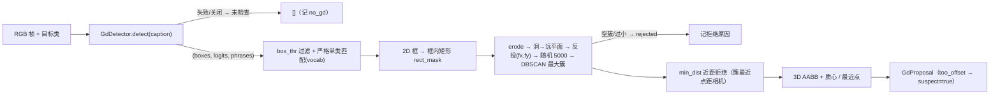

# `grounding_dino` —— GD 3D 提议源（GD proposal source）

> **当前状态：已与 policy 分离。** `vlfm/policy/tsp3d_objectnav_policy.py` 不再导入或调用本目录；代码原样保留，等待重新设计。下文描述的是旧 GD 集成，不是当前 final policy 的行为。

`vlfm/tsp3d_models/grounding_dino/` 把 GroundingDINO（2D 开放词检测）组织成**第二、独立的 3D 提议器**：每 `every_n` 帧消费一次原始观测（RGB + 目标文本 + 相机内外参），沿「2D 框 → 框内区域 → 深度反投 → 点簇 → 3D AABB」链产出 3D 候选；候选与 TSP3D 检测框做**帧级合票**后交给记忆系统。GD 点集**不注入**预热融合链，GD 框**不触发** TSP3D 再查询。


## 1. 作用（做什么 / 不做什么）

**做什么**

- **单帧提议**：`GdProposer.propose(rgb, depth_m, cam, target_classes, robot_xy, rng)` → `List[GdProposal]`。
  每个提议 = 一个世界系 3D AABB（8 角点 + 质心 + 最近点） + 类别对齐结果 + 2D 框 + 诊断字典。
- **帧级合票**（`provenance.py`，纯函数）：帧候选集 = `TSP3D 框 ∪ GD 提议`
  - `BOTH` —— GD 提议与**已准入**的 TSP3D 候选空间共位
    （`same_object`：XY 质心距离 ≤ `merge_dist`，或 AABB `IaU ≥ merge_iau`，或包含度 ≥ 0.8）→ 互相印证（强票）；
  - `GD` —— 仅 GD（单票）→ 以 suspicious（pending/soft）写入，可被既有生命周期回收；
  - `TSP3D` —— 仅 TSP3D → 既有行为不变。
- **准入 / 锁定规则**（`is_lockable` / `admit_as_suspicious`，准确优先默认）：单票 `GD` 条目永不触发 explore → navigate 锁定（`weak_guard=True`）；`admit_as_suspicious(BOTH)=False`。
- **诊断计数**：`proposer.summary() → {frames, boxes_above_thr, proposals, rejects}`。

**不做什么**

- 不改预热融合链；GD 点集不进入融合，也不作为 TSP3D 的 ROI 再查询输入；
- 不产生负证据：`client.GdDetector` 全链路守卫，GD 服务失败/关闭一律返回「未检查」（`None`），绝不对候选做否定判定；
- 不属于本包的职责：候选写入/回收/锁定时机由调用方（记忆系统）决定。


## 2. 代码组成

| 文件 | 内容 | 主要对象 / 函数 |
| :--- | :--- | :--- |
| `config.py` | 全部旋钮（唯一配置处，无逻辑） | `GdProposalConfig` |
| `types.py` | 纯数据载体（无行为） | `CameraView` `GdProposal` `Tsp3dCandidate` `MatchResult` `ProposalStats` |
| `vocab.py` | 类级文本对齐：归一化 / 别名 / 严格单类匹配 / caption 构造 | `DEFAULT_VOCAB`（6 类）、`normalize_phrase` `singularize` `build_alias_map` `canonicalize` `match_phrase` `build_caption` |
| `client.py` | 受保护的 GD 服务访问（端口 12181） | `GdDetector.detect → (boxes_xyxy_norm, logits, phrases) \| None` |
| `region.py` | 2D 框 → 世界系点簇（框内矩形替代 SAM 掩码角色） | `rect_mask` `erode_mask` `depth_holes_to_far` `backproject_mask` `random_subarray` `largest_cluster` `region_points_world` `too_offset_rect` |
| `boxes.py` | 3D AABB 几何（供建候选与合票） | `aabb_corners` `aabb_center` `nearest_point` `intra_camera_distance` `iau_3d` `containment` `same_object` |
| `proposer.py` | 单帧提议主流程 + 计数器 | `GdProposer.propose` / `_build` / `summary`；`should_run(step, every_n)` |
| `provenance.py` | 合票与准入/锁定规则（纯函数） | `attach_votes` `merge_vote` `admit_as_suspicious` `is_lockable`；常量 `TSP3D` / `GD` / `BOTH` |
| `__init__.py` | 包导出面（统一入口，含 `__all__`） | — |

### 单帧数据流



帧级合票在调用方完成：`attach_votes(proposals, tsp3d_candidates, cfg)` → 每项 `(proposal, vote, matched_idx)`。


## 3. 接口速览（用法）

```python
import numpy as np
from vlfm.tsp3d_models.grounding_dino import (
    GdProposalConfig, GdProposer, CameraView, attach_votes, should_run,
)

proposer = GdProposer(GdProposalConfig(box_thr=0.4, every_n=1))
if should_run(step, proposer.cfg.every_n):
    cam = CameraView(fx, fy, H, W, tf_camera_to_episodic, min_depth, max_depth)
    rng = np.random.RandomState((det_seed * 100003 + step) & 0x7FFFFFFF)
    proposals = proposer.propose(rgb, depth_m, cam, target_classes, robot_xy, rng)
    for prop, vote, matched_idx in attach_votes(proposals, tsp3d_candidates, proposer.cfg):
        ...  # vote == BOTH → 印证 matched_idx 条目；vote == GD → 按可疑条目写入
```

- **提议输出**（`GdProposal` 字段）：`box_px`（2D 像素框）、`conf`（logits ≥ `box_thr`）、
  `phrase` / `canon`（类别对齐）、`points_world`（最大簇点）、`centroid` / `box8` /
  `surface`（世界系几何）、`n_points`、`suspect`（`too_offset` 标记）、`diag`。
- **合票输入**（`Tsp3dCandidate`）：`centroid` / `box8` / `conf` / `admitted`
  （已过准入门的 TSP3D 候选才算「TSP3D 票」）。
- **诊断**：`proposer.summary()`；拒绝键 `below_thr` / `other_class` / `tiny_box` /
  `eroded_empty` / `no_cluster` / `too_close` / `no_gd`。
- **文本对齐**（`vocab.py`）：`normalize_phrase` / `singularize` / `build_alias_map` /
  `match_phrase`（严格单类；多词变体不映射）/ `build_caption`（style：`"vocab"` 类列表 /
  `"target"` 仅目标类）。


## 4. 配置旋钮（`GdProposalConfig`）

| 组 | 字段（默认值） | 含义 |
| :--- | :--- | :--- |
| 帧对齐 | `enabled=True`、`every_n=1` | 每 N 帧运行一次 GD |
| 检测侧 | `port=12181`、`box_thr=0.4`、`caption_style="vocab"`、`max_boxes=2` | 服务端口 / logits 阈值（GD 尺度）/ caption 风格 / 每帧最多建框数（成本闸） |
| 2D → 3D 链 | `erode_iters=5`、`min_pixels=256`、`rand_subarray=5000`、`dbscan_eps=0.2`、`dbscan_min_points=100`、`min_dist=1.0` | 腐蚀 / 过小矩形闸 / 随机子采样 / DBSCAN 参数 / 近距拒绝（米） |
| 合票 | `merge_dist=0.5`、`merge_iau=0.3` | 「同一物体」的质心距离（米）/ AABB IaU 门槛 |
| 单票策略 | `weak_guard=True` | 单票 `GD` 不可锁定（准确优先） |


## 5. 结构来源（自 VLFM 迁移 / 适配 / 新增）

| VLFM 机制 | 本包对应 | 类型 |
| :--- | :--- | :--- |
| `GroundingDINOClient.predict(rgb, caption)` + `filter_by_class` | `client.GdDetector` + `vocab.match_phrase`（严格单类） | 迁移 + 适配 |
| `non_coco_threshold 0.4`（单检测器场景） | `box_thr = 0.4` | 适配 |
| `MobileSAM.segment_bbox` → mask | 框内矩形（`region.rect_mask`） | 适配（角色替换：`too_offset` 只看包围矩形） |
| `_extract_object_cloud`：erode → 洞→远平面 → 反投 → 随机 5000 → DBSCAN 最大簇 | `region.region_points_world` | 迁移 |
| `too_offset` → 随机 `range_id` | `region.too_offset_rect` → `GdProposal.suspect`（由调用方按可疑写入） | 适配 |
| `update_explored`（近距回看删标） | 既有 suspicious 近场迟滞 / soft-only 空地擦除 | 适配 |
| `dist < 1.0 m` 拒绝 | `min_dist`（簇最近点距相机） | 迁移 |
| 无跨帧去重（点拼接 + 最近点） | `provenance.attach_votes`（帧级）+ 既有 EMA 记忆合并（跨帧） | 新增 |
| 值地图不受 GD 框影响 | 同（值地图冻结） | 一致 |
